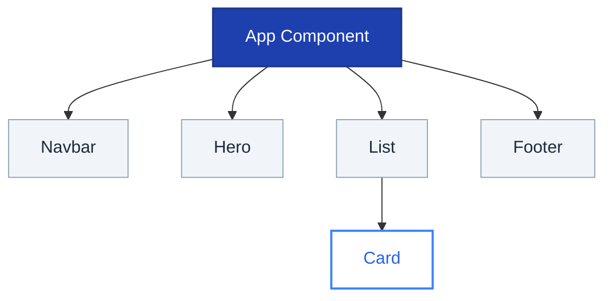
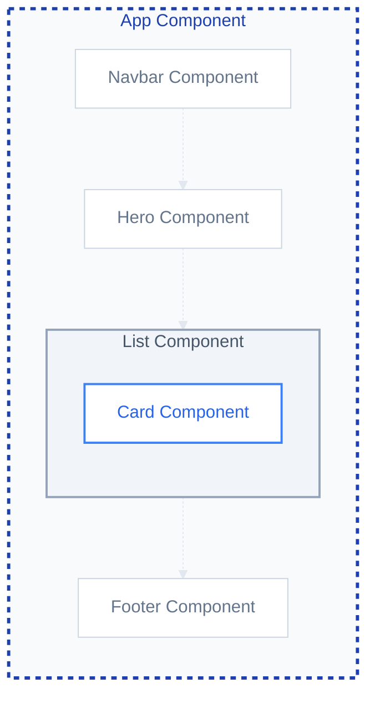
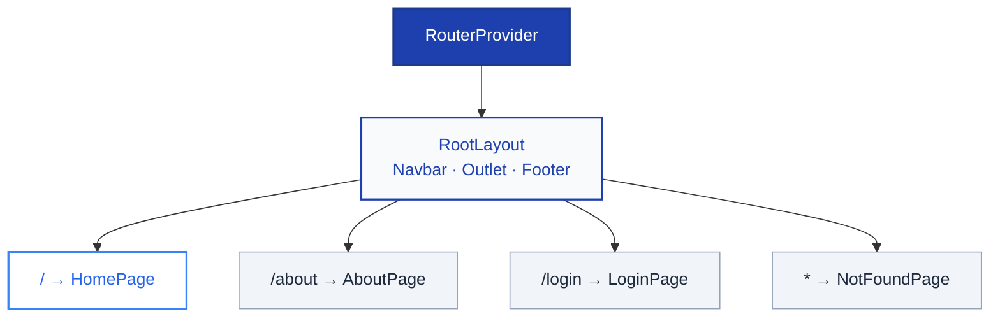

# ReactJS

## Table of Contents

1. [Introduction to React](#1-introduction-to-react)
2. [Environment Setup and Prerequisites](#2-environment-setup-and-prerequisites)
3. [JavaScript vs. TypeScript in React](#3-javascript-vs-typescript-in-react)
4. [Creating Your First React App with Vite](#4-creating-your-first-react-app-with-vite)
5. [Understanding the Project Structure](#5-understanding-the-project-structure)
6. [Adding TailwindCSS to Your Project](#6-adding-tailwindcss-to-your-project-tailwind-css-v4)
7. [Components in React](#7-components-in-react)
8. [JSX and TSX](#8-jsx-and-tsx)
9. [Props and Component Communication](#9-props-and-component-communication)
10. [Event Handling](#10-event-handling)
11. [Introduction to React Hooks](#11-introduction-to-react-hooks)
12. [Forms and Validation](#12-forms-and-validation)
13. [Fetch API/Axios](#13-fetch-api-or-axios)
14. [React Router](#14-react-router)

---

## 1. Introduction to React

React is a **JavaScript library for building user interfaces** — created by **Meta (formerly Facebook)** and used by some of the world's most popular websites and applications.

Instead of writing the entire page from scratch whenever something changes, React lets you build your UI from **small, reusable pieces called components**. Each component handles its own look and behavior, making your code easier to write, read, and maintain as your application grows.

React is especially powerful for building **Single Page Applications (SPAs)** — web apps that feel fast and responsive because they update content on screen without ever reloading the entire page.

#### What is a Single Page Application (SPA)?

A SPA loads **one main HTML page** once, then updates the content dynamically using JavaScript — without ever reloading the whole page. This makes the app feel faster and smoother, similar to a desktop application.

In React, when a user clicks a link to go from the Home page to the Profile page, React swaps out the components on screen instead of loading a new page from the server. The URL in the browser changes, but the page itself never reloads — making the app feel instant and smooth.

---

### Why Do We Use React?

Building a modern web application without React means writing a lot of manual code just to keep the page in sync with the data. Every time something changes — a button is clicked, a form is submitted, or new data arrives — you have to find the right element in the page and update it yourself. This becomes messy and hard to manage as the app grows.

React solves this by letting you describe **what the UI should look like**, and automatically updating the page whenever the data changes — no manual work needed.

| Problem without React | How React Solves It |
|:--|:--|
| Manually finding and updating page elements | React updates the UI automatically when data changes |
| Code becomes hard to manage as apps grow | Components keep code small, focused, and reusable |
| Hard to reuse UI across different pages | The same component can be used anywhere in the app |
| Hard to track what caused a bug | Each component manages its own data and logic |

---

### Key Features of React

#### Declarative UI
With React, you describe **what the UI should look like** for a given situation — React figures out **how** to update the page to match. Think of it like ordering food at a restaurant: you tell the waiter what you want, not how to cook it. In practice, when a user updates their profile bio, you update the data and React re-renders the page automatically (re-rendering means React recalculates and refreshes only the parts of the UI that changed) — no manual work needed.

#### Component-Based Architecture
React apps are built from **small, independent, reusable pieces called components** — similar to LEGO bricks that snap together to form the full UI. Each component manages its own look and behavior and can be reused anywhere in the app. The Event App, for example, is assembled from a `Navbar`, a `Hero`, an `EventList`, and a `Footer` — each built separately and combined together.

#### Virtual DOM
Every time data changes, React does not update the entire page. Instead, it works with a **[Virtual DOM](https://legacy.reactjs.org/docs/faq-internals.html#what-is-the-virtual-dom)** — a lightweight copy of the real page — to calculate exactly what changed and update only those parts. When a user likes a post, React touches only that like button, leaving everything else on the page untouched.

#### Large Ecosystem and Community
React has one of the largest developer communities in frontend development, with a rich set of ready-made libraries for almost every need — `React Router` for navigation, `Axios` for API calls, `Tailwind CSS` for styling, `React Hook Form` for forms, and `Redux` or `Zustand` for managing complex state. If you get stuck, answers are easy to find.

---

### Where Can React Be Used?

React is flexible — the same knowledge can be used to build far more than just websites.

| Platform | Tool / Framework | Real-World Examples | Learn More |
|:--|:--|:--|:--|
| **Web** | React DOM | Dashboards, e-commerce sites, social media apps | [react.dev](https://react.dev/reference/react-dom) |
| **Mobile** | React Native | Instagram, Facebook, Airbnb mobile apps | [reactnative.dev](https://reactnative.dev/) |
| **Desktop** | Electron | Visual Studio Code, Slack, Discord | [electronjs.org](https://www.electronjs.org/) |
| **3D / VR** | React Three Fiber | 3D product viewers, immersive web experiences | [pmnd.rs](https://docs.pmnd.rs/react-three-fiber) |

---

> React helps developers build **modern, fast, and scalable user interfaces** by using reusable components and
> efficiently updating the UI when data changes.
---

## 2. Environment Setup and Prerequisites

### 1. Node.js and npm

**Node.js** is a runtime that lets JavaScript run outside the browser — on your machine.

When you install Node.js, **npm (Node Package Manager)** is included automatically. npm is the tool you use to install React libraries, Tailwind, and any other package your project needs — similar to how you install apps from an app store, but for code libraries.

- Download from: [https://nodejs.org/](https://nodejs.org/) — always choose the **LTS** version (Long Term Support), which is the stable, recommended release.

```bash
node -v
npm -v
```

---

### 2. Code Editor (IDE)

Two great options for React development:

#### Option 1 — IntelliJ IDEA (by JetBrains)
A powerful, full-featured IDE with built-in support for JavaScript, TypeScript, and React — no extensions required for the basics.
- Download: https://www.jetbrains.com/idea/

#### Option 2 — Visual Studio Code (VS Code)
A free, lightweight, and open-source editor with excellent React support through extensions.
- Download: https://code.visualstudio.com/

- **Recommended Extensions:**
  - **ES7+ React/Redux/React-Native snippets**: Quick shortcuts (e.g., type `rfce` to scaffold a component).
  - **Prettier**: Automatic code formatting.
  - **ESLint**: Finds and fixes code issues.
  - **Tailwind CSS IntelliSense**: Autocomplete for Tailwind classes.

---

### 3. Basic Knowledge Prerequisites

React builds on top of the fundamentals. To get started comfortably, you should have a basic understanding of:

- **HTML** — how web pages are structured using elements like `<div>`, `<h1>`, and `<button>`.
- **CSS** — how to style and lay out elements on a page.
- **Modern JavaScript (ES6+)** — especially arrow functions, destructuring (extracting values from objects or arrays into variables), template literals, and array methods like `map` and `filter`, as these are used constantly in React code.

> You do not need to be an expert in any of these. A working knowledge is enough to follow along and build confidence as you go.

---

## 3. JavaScript vs. TypeScript in React

Before creating your first React project, you need to make one important decision: **JavaScript or TypeScript?** Understanding the difference now will help you make an informed choice — and explain why the Vite command you run next uses `--template react-ts`.

### JavaScript (JS)

JavaScript is the standard language of the web. It is flexible, beginner-friendly, and works in every browser without any extra setup. However, JavaScript is **loosely typed** — meaning you can store any kind of data in any variable without declaring what type it should be. This flexibility can lead to bugs that only appear when the app is actually running, which can be hard to track down.

```js
// JavaScript
let eventTitle = "React Workshop";
eventTitle = 100; // No warning — JavaScript allows this
                  // Bug only discovered when the app breaks at runtime
```

### TypeScript (TS)

TypeScript is **JavaScript with types added on top**. You declare what kind of data each variable is allowed to hold — a string, a number, an object — and TypeScript checks this as you write code. If you make a mistake, your editor highlights it immediately, before you even run the app.

```ts
// Variable — must always be a string
let eventTitle: string = "React Workshop";
eventTitle = 100; // ❌ Error — a number is not allowed here

// Array — must only contain strings
let tags: string[] = ["React", "Workshop", "Frontend"];
tags.push(42); // ❌ Error — only strings allowed in this array

// Object — shape is defined upfront
type Event = {
  title: string;
  capacity: number;
  isOnline: boolean;
};

const event: Event = {
  title: "React Workshop",
  capacity: 50,
  isOnline: true,
};

// Function — parameters and return value are typed
function getEventSummary(title: string, capacity: number): string {
  return `${title} — ${capacity} seats available`;
}

getEventSummary("React Workshop", "fifty"); // ❌ Error — second argument must be a number
```

TypeScript does not replace JavaScript — it compiles down to plain JavaScript in the end. You are simply writing JavaScript with an extra safety layer.

### Comparison

| Feature | JavaScript (JS) | TypeScript (TS) |
|:--|:--|:--|
| **Type Safety** | No — errors appear at runtime | Yes — errors caught while coding |
| **Autocompletion** | Basic | Advanced — editor understands your data |
| **Learning Curve** | Lower | Slightly higher — extra syntax to learn |
| **File Extensions** | `.js` / `.jsx` | `.ts` / `.tsx` |
| **Industry Usage** | Common | Standard in modern React projects |


**TypeScript** makes your code more reliable, easier to maintain, and gives you much better support in your editor.

> TypeScript is still JavaScript at its core — all the JavaScript you already know still applies. You are simply adding types on top to catch mistakes earlier and write more predictable code.

---

## 4. Creating Your First React App with Vite

### 1. What is Vite and Why Do We Need It?

**Vite** (pronounced *"veet"* — French for "fast") is the tool that sets up and runs your React project. You cannot simply open a React file in a browser — React uses **JSX or TSX**, a special syntax that browsers do not understand. Vite takes care of converting that code into plain JavaScript the browser can read, sets up all your project files, and runs a local development server so you can preview your app instantly as you code.

Vite handles everything behind the scenes — setting up your project structure, converting your code, and serving it in the browser — so you can focus entirely on building your app.

> **Note:** Vite plays a similar role to **Maven or Gradle** — a build tool that manages your project setup and build process, but for the frontend.

Before Vite, the standard tool was **Create React App (CRA)**. It served the same purpose but has since become slow and is no longer recommended by the React team. Vite has fully replaced it.

| | Create React App (CRA) | Vite |
|:--|:--|:--|
| **Status** | Outdated | Modern standard |
| **Startup speed** | Slow | Very fast |
| **Live updates** | Slow full reloads | Instant updates on save |
| **Recommended** | No | Yes |

---

### 2. Creating a New Project with Vite

Open your terminal and run the following command to create a new React project:

```bash
npm create vite@latest my-react-app -- --template react-ts
```

Here is what each part means:

| Part | What it does |
|:--|:--|
| `npm create vite@latest` | Tells npm to use Vite to create a new project |
| `my-react-app` | The name of your project folder — you can change this to anything |
| `-- --template react-ts` | Sets up the project with **React** and **TypeScript** |

> To use plain JavaScript instead, replace `react-ts` with `react`.

After running the command, Vite generates a ready-to-use project folder with all the files you need.

---

### 3. Installing Dependencies and Running the App

When Vite creates the project, it does **not** download the libraries (packages needed to compile and run the app, such as `react`, `react-dom`, and `typescript`) automatically — it only creates a list of what is needed (in `package.json`). To download them, run:

```bash
cd my-react-app
npm install
```

This downloads all the required libraries into a `node_modules` folder. You only need to do this once per project.

Once installation is complete, start the development server:

```bash
npm run dev
```

Vite will start a local server and give you a URL — usually `http://localhost:5173` — where you can see your app running live in the browser. Every time you save a file, the browser updates instantly.

---

## 5. Understanding the Project Structure

When you create a new React project with Vite, it generates several files and folders. Here’s a quick overview of what they do:

### 1. Root Files
- **`index.html`**: The main entry point for the browser. It contains a `<div id="root"></div>` where your entire React app will be "injected."
- **`package.json`**: This file tracks your project's dependencies (like React and Tailwind) and contains scripts like `npm run dev`.
- **`vite.config.ts`**: The configuration file for Vite. This is where we add plugins (like Tailwind CSS).
- **`tsconfig.json`**: Contains settings for TypeScript.
- **`node_modules/`**: A large folder containing all the external libraries your project needs. You don't need to touch this.

### 2. The `src` Folder
This is where you will spend **99% of your time**.
- **`main.tsx`**: The bridge between your React code and the `index.html`. It "renders" your `App` component into the DOM.
  - **`StrictMode`**: You'll see this tag in `main.tsx`. It's a tool that re-renders components an extra time in development to find bugs. Don't worry, it doesn't affect the final website!
- **`App.tsx`**: Usually the "Root" component of your application. Everything else starts from here.
- **`index.css`**: Your global styles (where we added `@import "tailwindcss";`).
- **`assets/`**: A place to store images, icons, and fonts.
- **`components/`**: (Optional but recommended) A folder to store your reusable pieces of UI like `Navbar.tsx` or `Footer.tsx`.

### 3. The `public` Folder
Contains static files that you want to be served as-is, such as the `favicon.ico` (the small icon in the browser tab).

---

## 6. Adding TailwindCSS to Your Project (Tailwind CSS v4)

**Tailwind CSS** is a utility-first CSS framework that allows you to style your application directly in your HTML/JSX.
The latest version (**v4**) is significantly faster and easier to set up because it integrates directly with **Vite**.

### 1. Installation

To add Tailwind CSS v4 to your Vite project, run the following command in your project folder:

```bash
npm install tailwindcss @tailwindcss/vite
```

- `tailwindcss`: The core library.
- `@tailwindcss/vite`: The official plugin that makes Tailwind work with Vite.

### 2. Configure the Vite Plugin

Open your `vite.config.ts` (or `vite.config.js`) file and add the Tailwind CSS plugin:

```typescript
import {defineConfig} from 'vite'
import react from '@vitejs/plugin-react'
import tailwindcss from '@tailwindcss/vite'

// https://vite.dev/config/
export default defineConfig({
  plugins: [
    react(),
    tailwindcss(),
  ],
})
```

### 3. Add Tailwind to Your CSS

Open your global CSS file (usually `src/index.css`) and add the following line at the very top:

```css
@import "tailwindcss";
```

That’s it! In v4, you no longer need `tailwind.config.js` or `postcss.config.js` for most standard projects. Tailwind
will automatically find your classes in your `.tsx` and `.jsx` files.

### 4. Test It Out!

Now you can use Tailwind classes in your components. Open `src/App.tsx` and try adding some classes to a heading:

```tsx
function App() {
  return (
          <div className="flex justify-center items-center h-screen bg-slate-100">
            <h1 className="text-4xl font-extrabold text-blue-600 drop-shadow-md">
              Hello ReactJS with Tailwind CSS!
            </h1>
          </div>
  )
}
```

If you see a large, bold, blue heading centered on a light gray background, Tailwind is working correctly!

---

## 7. Components in React

Think of a component as a **self-contained piece of the UI** — it has its own structure, its own logic, and its own appearance. Instead of writing an entire page in one large file, you split it into small, focused components. Each component does one thing well and can be reused anywhere in the app.

For example, a `Navbar` component is responsible only for the navigation bar. An `Card` component displays a single event. These components are then combined together to build the full page.

---

### How Components Fit Together

Every React app starts from a single root component — usually called `App` — which contains all other components nested inside it, forming a tree.



Another way to picture it — components are like **boxes inside boxes**, each responsible for one section of the screen:



- **Parent Component** — renders other components inside it (`App` contains `Navbar`, `Hero`, `List`, `Footer`)
- **Child Component** — rendered inside a parent (`Card` is a child of `List`)
- **Nesting** — components are placed inside each other just like HTML tags

---

A component is a **JavaScript or TypeScript function that returns JSX**. Every component follows the same structure.

```tsx
// 1. The component name always starts with a capital letter
const Card = () => {

  // 2. Regular JavaScript — variables and methods work exactly as in any JS/TS function
  const title = "Getting Started with React";
  const description = "Learn how to build modern web apps.";
  const isNew = true;

  const getLabel = () => {
    return isNew ? "New" : "Updated";
  };

  // 3. The return statement contains JSX — the HTML-like structure that appears on screen
  //    JSX syntax (curly braces, expressions, rules) is covered in the next section
  return (
          <div>
            <span>{getLabel()}</span>
            <h2>{title}</h2>
            <p>{description}</p>
          </div>
  );
};

// 4. Export the component so other files can import and use it
export default Card;
```

To use this component, write it like an HTML tag with a capital letter:

```tsx
<Card />
```

When React sees `<Card />`, it calls the function and renders whatever JSX it returns. Because it is just a function, you can place `<Card />` anywhere in the app and reuse it as many times as you need.

Functional components can also use **React Hooks** (`useState`, `useEffect`, etc.) to manage data and side effects.

---

## 8. JSX and TSX

Every React component ends with a `return` statement containing HTML-like code. That syntax is called **JSX** — and this section explains exactly what it is and how it works.

---

### What is JSX?

**JSX** lets you write HTML-like structure directly inside a JavaScript or TypeScript function. Instead of keeping your UI in a separate HTML file and your logic in a JS file, JSX lets you describe both in one place.

Even though it looks like HTML, JSX is not HTML — it is JavaScript. Before the browser runs your code, a tool called **[Babel](https://babeljs.io/)** transforms all JSX into plain JavaScript function calls behind the scenes. You never have to do this manually — it happens automatically.

---

### Embedding JavaScript with `{ }`

The key difference between JSX and plain HTML is that you can embed **any JavaScript expression** inside curly braces `{ }`.

```tsx
const Card = () => {
  const title = "Getting Started with React";
  const isNew = true;

  return (
          <div>
            <h2>{title}</h2>                          {/* variable */}
            <span>{isNew ? "New" : "Updated"}</span>  {/* expression */}
            <p>{2 + 2}</p>                            {/* calculation */}
          </div>
  );
};
```

Anything inside `{ }` is evaluated as JavaScript — a variable, a method call, a calculation, or a conditional expression. Plain text outside `{ }` is treated as static content.

---

### The Rules of JSX

JSX looks like HTML but follows a few stricter rules:

**1. A component must return one root element**

```tsx
// ❌ Two sibling elements — not allowed
return (
        <h2>Title</h2>
<p>Description</p>
);

// ✅ Wrapped in a single parent
return (
        <div>
          <h2>Title</h2>
          <p>Description</p>
        </div>
);

// ✅ Or use a Fragment — renders no extra element in the browser
return (
        <>
          <h2>Title</h2>
          <p>Description</p>
        </>
);
```

**2. All tags must be closed**

```tsx
// ❌ HTML allows this — JSX does not

  <br>

    // ✅ Every tag must be closed
    
    <br />
```

**3. Use `className` instead of `class`**

```tsx
// ❌ class is a reserved word in JavaScript
<div class="card">

  // ✅ JSX uses className
  <div className="card">
```

---


### JSX vs TSX

**JSX** is used in `.jsx` files (JavaScript). **TSX** is the exact same syntax used in `.tsx` files (TypeScript) — the only difference is that you can add types to your data.

```tsx
// JSX — no types
const title = "Getting Started with React";

// TSX — same thing, with a type annotation
const title: string = "Getting Started with React";
```

Here is the same `EventCard` component written in both — the JSX and TSX are identical except for the `type Event` definition and the `: Event` annotation on the variable:

**JSX** (`EventCard.jsx`):

```jsx
const EventCard = () => {

  const event = {
    id: 1,
    title: 'Tech Innovators Summit 2026',
    date: 'March 25, 2026',
    time: '09:00 AM',
    location: 'Silicon Valley Convention Center',
    attendees: 1200,
    image: 'https://images.unsplash.com/photo-1501281668745-f7f57925c3b4?auto=format&fit=crop&q=80&w=800',
    category: 'Technology',
  }

  return (
          <div>
            <span>{event.category}</span>
            
            <p>{event.date} · {event.time}</p>
            <h3>{event.title}</h3>
            <p>{event.location}</p>
            <p>{event.attendees.toLocaleString()} Attendees</p>
            <button>Register Now</button>
          </div>
  );
};

export default EventCard;
```

**TSX** (`EventCard.tsx`):

```tsx
// TypeScript requires you to describe the shape of your data using a type
type Event = {
  id: number;
  title: string;
  date: string;
  time: string;
  location: string;
  attendees: number;
  image: string;
  category: string;
};

const EventCard = () => {

  // The : Event annotation tells TypeScript what this object must look like
  const event: Event = {
    id: 1,
    title: 'Tech Innovators Summit 2026',
    date: 'March 25, 2026',
    time: '09:00 AM',
    location: 'Silicon Valley Convention Center',
    attendees: 1200,
    image: 'https://images.unsplash.com/photo-1501281668745-f7f57925c3b4?auto=format&fit=crop&q=80&w=800',
    category: 'Technology',
  };

  return (
          <div>
            <span>{event.category}</span>
            
            <p>{event.date} · {event.time}</p>
            <h3>{event.title}</h3>
            <p>{event.location}</p>
            <p>{event.attendees.toLocaleString()} Attendees</p>
            <button>Register Now</button>
          </div>
  );
};

export default EventCard;
```

---


## 9. Props and Component Communication

**Props** (short for "properties") are how you pass data from one component to another — making components dynamic and reusable rather than hardcoded.

Think of props like **arguments passed to a function**. Just as a function behaves differently depending on what you pass in, a component displays different content depending on the props it receives.

---

### Step 1 — A Static Component (No Props)

Here is a `Navbar` component with the title and navigation items **hardcoded inside it**. It works, but it is fixed — you cannot reuse it with different content.

```tsx
import React from 'react';
import {Home, Info, Star, Phone, Calendar} from "lucide-react";

type NavItem = {
  label: string;
  href: string;
  icon: React.ElementType; // accepts any React component (e.g. an icon) so it can be stored in an array and rendered dynamically
}

const Navbar = () => {

  const title: string = "EventApp";

  const items: NavItem[] = [
    {label: 'Home', href: '#', icon: Home},
    {label: 'About', href: '#', icon: Info},
    {label: 'Features', href: '#', icon: Star},
    {label: 'Contact', href: '#', icon: Phone}
  ];

  return (
          <>
            <nav className="fixed w-full z-50 transition-all duration-300 bg-slate-900/95 backdrop-blur-md border-b border-slate-800 shadow-xl">
              <div className="max-w-7xl mx-auto px-4 sm:px-6 lg:px-8">
                <div className="flex items-center justify-between h-20">
                  {/* Logo and Brand */}
                  <div className="flex items-center group cursor-pointer">
                    <div className="flex-shrink-0 bg-red-600 p-2 rounded-xl group-hover:bg-red-700 transition-colors duration-300">
                      <Calendar className="h-6 w-6 text-white" size={22}/>
                    </div>
                    <span className="ml-3 font-bold text-2xl tracking-tight text-white group-hover:text-red-500 transition-colors duration-300">{title}</span>
                  </div>

                  {/* Desktop Menu */}
                  <div className="hidden md:block">
                    <div className="ml-10 flex items-center space-x-8">
                      {items.map((item, index) => {
                        const Icon = item.icon;
                        return (
                                <a
                                        key={index}
                                        href={item.href}
                                        className="flex items-center text-slate-300 hover:text-red-500 text-sm font-semibold"
                                >
                                  <Icon size={16} className="mr-2"/>
                                  {item.label}
                                </a>
                        )
                      })}
                      <button className="bg-red-600 text-white px-6 py-2.5 rounded-full font-bold text-sm hover:bg-red-700 transition-all flex items-center">
                        Get Started
                      </button>
                    </div>
                  </div>

                  {/* Mobile Menu Toggle */}
                  <div className="md:hidden flex items-center">
                    <input type="checkbox" id="mobile-menu-toggle" className="hidden peer"/>
                    <label htmlFor="mobile-menu-toggle"
                           className="inline-flex items-center justify-center p-2 rounded-lg text-slate-300 hover:bg-slate-800 cursor-pointer">
                      <svg className="block h-6 w-6" viewBox="0 0 24 24" fill="none" stroke="currentColor" strokeWidth="2">
                        <line x1="3" y1="12" x2="21" y2="12"></line>
                        <line x1="3" y1="6" x2="21" y2="6"></line>
                        <line x1="3" y1="18" x2="21" y2="18"></line>
                      </svg>
                    </label>
                  </div>
                </div>
              </div>
            </nav>
          </>
  );
};

export default Navbar;
```

> **lucide-react** is a React icon library — each icon (`Home`, `Info`, `Star`, etc.) is a React component you can import and render directly. Install it with `npm install lucide-react`.

> **[`React.ElementType`](https://react-typescript-cheatsheet.netlify.app/docs/basic/getting-started/basic_type_example/#useful-react-prop-type-examples)** is a TypeScript type that represents any React component. Storing [lucide-react](https://lucide.dev/) icons as `React.ElementType` in the array is what allows them to be rendered dynamically inside `.map()`.

---

### Step 2 — The Problem With Hardcoded Data

What if a second page needs a `Navbar` with a different title or different menu items? With the current approach, you would have to duplicate the entire component and change the values manually — that defeats the purpose of reusable components.

Props solve this by letting you move the data outside the component and pass it in from the parent.

---

### Step 3 — Making the Navbar Accept Props

Add a `NavbarProps` type that describes what the component expects, then replace the hardcoded variables with those props:

```tsx
import React from 'react';
import {Calendar} from 'lucide-react';

// export makes this type available to other files
// Without export, NavItem can only be used inside this file
// With export, any other file can import it with: import type { NavItem } from './Navbar'
export type NavItem = {
  label: string;
  href: string;
  icon: React.ElementType;
};

// export here for the same reason — the parent component needs NavbarProps
// if it ever wants to type-check the props it passes to <Navbar />
export type NavbarProps = {
  items: NavItem[];   // an array of NavItem objects
  title: string;      // the navbar brand title
};

// Props are destructured directly in the function signature
const Navbar = ({ items, title }: NavbarProps) => {
  return (
          <>
            <nav className="fixed w-full z-50 transition-all duration-300 bg-slate-900/95 backdrop-blur-md border-b border-slate-800 shadow-xl">
              <div className="max-w-7xl mx-auto px-4 sm:px-6 lg:px-8">
                <div className="flex items-center justify-between h-20">

                  {/* Logo and Brand */}
                  <div className="flex items-center group cursor-pointer">
                    <div className="flex-shrink-0 bg-red-600 p-2 rounded-xl group-hover:bg-red-700 transition-colors duration-300">
                      <Calendar className="h-6 w-6 text-white" size={22}/>
                    </div>
                    <span className="ml-3 font-bold text-2xl tracking-tight text-white group-hover:text-red-500 transition-colors duration-300">{title}</span>
                  </div>

                  {/* Desktop Menu */}
                  <div className="hidden md:block">
                    <div className="ml-10 flex items-center space-x-8">
                      {items.map((item, index) => {
                        const Icon = item.icon;
                        return (
                                <a
                                        key={index}
                                        href={item.href}
                                        className="flex items-center text-slate-300 hover:text-red-500 text-sm font-semibold"
                                >
                                  <Icon size={16} className="mr-2"/>
                                  {item.label}
                                </a>
                        )
                      })}
                      <button className="bg-red-600 text-white px-6 py-2.5 rounded-full font-bold text-sm hover:bg-red-700 transition-all flex items-center">
                        Get Started
                      </button>
                    </div>
                  </div>

                  {/* Mobile Menu Toggle */}
                  <div className="md:hidden flex items-center">
                    <input type="checkbox" id="mobile-menu-toggle" className="hidden peer"/>
                    <label htmlFor="mobile-menu-toggle"
                           className="inline-flex items-center justify-center p-2 rounded-lg text-slate-300 hover:bg-slate-800 cursor-pointer">
                      <svg className="block h-6 w-6" viewBox="0 0 24 24" fill="none" stroke="currentColor" strokeWidth="2">
                        <line x1="3" y1="12" x2="21" y2="12"></line>
                        <line x1="3" y1="6" x2="21" y2="6"></line>
                        <line x1="3" y1="18" x2="21" y2="18"></line>
                      </svg>
                    </label>
                  </div>

                </div>
              </div>
            </nav>
          </>
  );
};

export default Navbar;
```

The component itself no longer knows what the title is or how many items there are — the **parent decides** and passes that data in.

Notice that both types are prefixed with `export`. This makes them available to other files that need to use the same types — for example, the parent component that builds the `navItems` array needs to know what shape each item must have.

To import an exported type in another file, use `import type`:

```tsx
import type { NavItem } from './Navbar';
```

`import type` is a TypeScript-only import — it is stripped out completely at runtime and has no effect on the compiled JavaScript. It signals clearly that you are importing something only for type checking, not for use as a value.

---

### Step 4 — Using the Component from a Parent

The parent component passes props directly on the component tag — written the same way as HTML attributes:

```tsx
import { Home, Info, Star, Phone } from 'lucide-react';
import Navbar from './Navbar';
import type { NavItem } from './Navbar';

const App = () => {

  const navItems: NavItem[] = [
    { label: 'Home',     href: '#', icon: Home  },
    { label: 'About',    href: '#', icon: Info  },
    { label: 'Features', href: '#', icon: Star  },
    { label: 'Contact',  href: '#', icon: Phone },
  ];

  return (
          <div>
            <Navbar title="EventApp" items={navItems} />
          </div>
  );
};
```

Data always flows **one way — from parent to child**. The `Navbar` receives `title` and `items` but cannot modify them. If the data needs to change, the parent must pass new values.

> **TypeScript benefit:** Because `NavbarProps` defines what the component expects, TypeScript will show an error if you forget a required prop, and your editor will autocomplete prop names as you type.

---

### Another Example — Toast Component

The `Toast` component is a good example of props with **optional values**, **union types**, and a **function prop** (`onClose`).

```tsx
import { CheckCircle2, X, AlertCircle, Info } from 'lucide-react';

// Union type — only these three string values are allowed
type ToastType = 'success' | 'error' | 'info';

type ToastProps = {
  message: string;
  type?: ToastType;    // "?" means optional — if not passed, the default below is used
  onClose: () => void; // a function passed as a prop — called when the X button is clicked
};

const Toast = ({ message, type = 'success', onClose }: ToastProps) => {

  const icons = {
    success: <CheckCircle2 className="text-emerald-500" size={20} />,
    error:   <AlertCircle  className="text-rose-500"    size={20} />,
    info:    <Info         className="text-blue-500"    size={20} />,
  };

  const backgrounds = {
    success: 'bg-emerald-50 border-emerald-100',
    error:   'bg-rose-50 border-rose-100',
    info:    'bg-blue-50 border-blue-100',
  };

  return (
          <div className="fixed bottom-8 right-8 z-[100]">
            <div className={`flex items-center p-4 rounded-2xl border-2 shadow-2xl min-w-[320px] ${backgrounds[type]}`}>

              <div className="mr-3">
                {icons[type]}
              </div>

              <div className="flex-1 mr-4">
                <p className="text-sm font-bold text-slate-900 leading-tight">
                  {message}
                </p>
              </div>

              <button
                      onClick={onClose}
                      className="p-1 hover:bg-black/5 rounded-lg transition-colors text-slate-400 hover:text-slate-600">
                <X size={16} />
              </button>

            </div>
          </div>
  );
};

export default Toast;
```

Three things this example introduces that the Navbar did not:

- **Optional prop with default** — `type?` is optional; `type = 'success'` in the destructuring sets a fallback value if the parent does not pass it
- **Union type** — `ToastType` restricts `type` to exactly three allowed strings; passing any other value is a TypeScript error
- **Function as a prop** — `onClose: () => void` means the parent passes a function, and the component calls it when the button is clicked

The same component handles all three toast types — the parent simply passes a different `type` and `message`. The `onClose` function is defined in the parent and passed down, so the parent controls what happens when the toast is dismissed:

```tsx
{/* type="success" — shows a green check icon */}
<Toast message="Event registered successfully!" type="success" onClose={() => console.log('Toast closed')} />

{/* type="error" — shows a red alert icon */}
<Toast message="Something went wrong. Please try again." type="error" onClose={() => console.log('Toast closed')} />

{/* type="info" — shows a blue info icon */}
<Toast message="New events are available." type="info" onClose={() => console.log('Toast closed')} />

{/* type omitted — falls back to the default value "success" */}
<Toast message="Changes saved." onClose={() => console.log('Toast closed')} />
```

---

### `type` vs `interface`

TypeScript gives you two ways to describe the shape of an object: `type` and `interface`. Both work for defining props — the difference is in flexibility and intent.

```tsx
// Using type — can describe any shape, union, or primitive
type NavbarProps = {
  title: string;
  items: NavItem[];
};

// Using interface — specifically for object shapes, can be extended
interface NavbarProps {
  title: string;
  items: NavItem[];
}
```

| | `type` | `interface` |
|:--|:--|:--|
| **Object shapes** | Yes | Yes |
| **Union types** (`'success' \| 'error'`) | Yes | No |
| **Extending** | Via `&` intersection | Via `extends` keyword |
| **Declaration merging** | No | Yes — same name declared twice merges |
| **Most common for React props** | Yes | Less common |

**`type` is the standard choice for React props** in modern codebases — it handles all common cases and is more flexible. Use `interface` when you specifically need to extend an existing definition or work with declaration merging.

---

### Organizing Types — Shared Types File

As a project grows, defining types inside every component file becomes messy and leads to duplication. The standard practice is to move shared types into a dedicated file.

```
src/
  types.ts          ← all shared types live here
  components/
    Navbar.tsx
    EventCard.tsx
```

**`src/types.ts`:**
```tsx
export type NavItem = {
  label: string;
  href: string;
  icon: React.ElementType;
};

export type NavbarProps = {
  title: string;
  items: NavItem[];
};
```

**`src/components/Navbar.tsx`:**
```tsx
import type { NavItem, NavbarProps } from '../types';

const Navbar = ({ title, items }: NavbarProps) => {
  // ...
};
```

`import type` is a TypeScript-only import — it tells the compiler these imports are only needed for type checking, not at runtime. This keeps the compiled output clean.

---

## 10. Event Handling

Props help display data, but to make an app interactive, React uses **event handling**.

An **event** is an action that happens in the browser.

Examples:
- Clicking a button
- Typing in an input field
- Submitting a form
- Moving the mouse
- Pressing a key

These actions let users interact with your app.

An **event handler** is a function that runs when an event happens.

Examples:
- Button click → show a message
- Typing → update data
- Form submit → check input

Event handlers tell React what to do after the user interacts.

> **React listens for user actions, then runs the correct function.**

Without event handlers, components only show content. With them, apps become dynamic and responsive.

---

### 1. Click Event

To handle a click, we define a function inside our component and "attach" it to a button using the `onClick` attribute.

```tsx
const Hero = () => {


  // scrollToEventsList
  const handleScrollToEvents = () => {
    document.getElementById("events-list")?.scrollIntoView({
      behavior: "smooth",
      block: "start",
    });
  };

  const handleCreateEvent = () => {
    alert("Handel Create Event");
  };


  return (
          <div className="relative flex flex-col justify-center items-center py-28 px-4 overflow-hidden bg-white border-b border-slate-100">

            <div className="absolute top-0 left-1/2 -translate-x-1/2 w-full h-full -z-10 overflow-hidden">
              <div className="absolute top-[-10%] left-[-10%] w-[40%] h-[40%] bg-red-50 rounded-full blur-[120px] opacity-60"></div>
              <div className="absolute bottom-[-10%] right-[-10%] w-[40%] h-[40%] bg-slate-100 rounded-full blur-[120px] opacity-60"></div>
            </div>

            <div className="max-w-5xl mx-auto flex flex-col items-center">
              <div className="flex items-center space-x-2 mb-8">
                  <span className="relative flex h-2 w-2">
                    <span className="animate-ping absolute inline-flex h-full w-full rounded-full bg-red-400 opacity-75"></span>
                    <span className="relative inline-flex rounded-full h-2 w-2 bg-red-600"></span>
                  </span>
                <span className="text-red-700 font-bold tracking-wider uppercase text-[10px]">
                        Plan Your Next Big Event
                    </span>
              </div>

              <h1 className="text-5xl md:text-7xl font-black text-slate-900 text-center mb-8">
                Welcome to <span className="text-red-600">Event App</span>
              </h1>

              <p className="text-slate-500 text-lg text-center max-w-2xl mb-12">
                The ultimate platform to manage and create events effortlessly.
              </p>

              <div className="flex flex-col sm:flex-row gap-6">
                <button onClick={handleCreateEvent} className="bg-red-600 text-white px-10 py-4 rounded-2xl font-bold">
                  Create Event
                </button>

                <button  onClick={handleScrollToEvents} className="bg-white border-2 border-slate-200 px-10 py-4 rounded-2xl font-bold">
                  Browse Events
                </button>
              </div>
            </div>
          </div>
  );
};

export default Hero;
```

> **Why no parentheses `()`?**  
> If you write `onClick={handleCreateEvent()}`, the function will run **immediately** when the component renders (you'll see the alert as soon as the page loads!). By writing `onClick={handleCreateEvent}`, you are telling React: *"Run this function only when the user actually clicks the button."*

---

### 2. The Event Object

Every event handler React calls automatically receives one argument: the **event object**. It describes exactly what happened — which element triggered it, what key was pressed, what the input's new value is, and so on.

Let's revisit `handleCreateEvent` from the `Hero` example and give it that parameter:

```tsx
// The Event Object
// React automatically passes an "event object" (e) to every handler.
// e.target        -> the actual DOM element that triggered the event
// e.currentTarget -> the element the handler is attached to (this <button>)
const handleCreateEvent = (e: React.MouseEvent<HTMLButtonElement>) => {
  console.log("e.target:", e.target);
  console.log("e.currentTarget:", e.currentTarget);
  alert("Handle Create Event");
};

<button onClick={handleCreateEvent}>Create Event</button>
```

Open the browser console and click **Create Event** — you'll see the actual `<button>` DOM element logged twice. Here `e.target` and `e.currentTarget` happen to be the same element because the click landed directly on the button. They start to differ once you attach a handler to a *parent* element and click something inside it (a common case: a card's `onClick` vs. a button nested inside that card) — `e.target` is always the exact element clicked, while `e.currentTarget` is always the element the handler was attached to.

> **Note:** `React` needs to be imported (`import React from "react"`) whenever you reference a type like `React.MouseEvent` directly, as done above.

`e` is an object with many fields on it — `e.target` and `e.currentTarget` are just the two you'll reach for most. If you `console.log(e)` inside `handleCreateEvent`, here's what you'd find worth knowing about:

| Field / Method         | Type                    | What it holds                                                                 |
|:-------------------------|:--------------------------|:----------------------------------------------------------------------------------|
| `e.target`                | `EventTarget`              | The exact DOM element the event originated on (see above).                        |
| `e.currentTarget`         | `HTMLButtonElement`        | The element `onClick` is attached to — matches the generic you gave `React.MouseEvent<...>`. |
| `e.type`                  | `string`                   | The event's name, e.g. `"click"`. Handy when one function handles several event types. |
| `e.clientX` / `e.clientY` | `number`                   | Mouse position (in pixels) relative to the browser window at the moment of the click. |
| `e.altKey` / `e.ctrlKey` / `e.shiftKey` / `e.metaKey` | `boolean` | Whether a modifier key was held down during the click — useful for shortcuts like "Ctrl+Click to open in new tab" behavior. |
| `e.detail`                | `number`                   | Click count — `2` on a double-click, `3` on a triple-click, etc.                  |
| `e.preventDefault()`      | method                     | Covered below — stops the browser's default reaction to the event.                |
| `e.stopPropagation()`     | method                     | Covered below — stops the event bubbling up to parent handlers.                   |


React doesn't hand you the raw browser event — it wraps it in a **SyntheticEvent**, a cross-browser object that behaves the same way in every browser (Chrome, Firefox, Safari, etc.), so you never have to write browser-specific event code.


```tsx
const handleSubmit = (e: React.FormEvent<HTMLFormElement>) => {
  e.preventDefault(); // without this, the page would refresh and your state would be lost
  console.log("Form submitted!");
};

<form onSubmit={handleSubmit}>...</form>
```

> **Note:** You only need to name the parameter (`e`) when you actually use it. `handleScrollToEvents`, back in the `Hero` example, ignores it entirely — that's perfectly fine, since JavaScript doesn't force you to declare arguments you don't use.

---

### 3. Click Event — EventCard Component

The `Hero` example defined the handler inside the component. Here, the handler comes **from outside — passed in as a prop**.

`EventCard` receives `onRegister` as a function prop and passes it directly to `onClick`. The component does not know or care what happens next — the **parent decides**.

```tsx
export type EventItem = {
  id: number;
  title: string;
  date: string;
  time: string;
  location: string;
  attendees: number;
  image: string;
  category: string;
};

export type EventItemProps = {
  event: EventItem;
  onRegister: () => void; // function passed from the parent — called when the button is clicked
};

const EventCard = ({ event, onRegister }: EventItemProps) => {

  // Destructure the event object to extract its properties and make the JSX cleaner
  const { id, image, category, date, time, title, location, attendees } = event;

  return (
          <div className="bg-white rounded-3xl overflow-hidden shadow-sm hover:shadow-2xl transition-all duration-500 border-2 border-slate-100 hover:border-red-100 group">
            <div className="relative h-64 overflow-hidden">
              
              <div className="absolute top-4 left-4">
                    <span className="bg-white/90 backdrop-blur-md text-slate-900 px-4 py-1.5 rounded-full text-xs font-bold shadow-sm">
                        {category}
                    </span>
              </div>
            </div>
            <div className="p-8">
              <div className="flex items-center text-slate-500 text-sm mb-4 space-x-4">
                <div className="flex items-center">
                  <svg className="w-4 h-4 mr-2 text-red-600" viewBox="0 0 24 24" fill="none" stroke="currentColor" strokeWidth="2" strokeLinecap="round" strokeLinejoin="round">
                    <rect x="3" y="4" width="18" height="18" rx="2" ry="2"></rect>
                    <line x1="16" y1="2" x2="16" y2="6"></line>
                    <line x1="8" y1="2" x2="8" y2="6"></line>
                    <line x1="3" y1="10" x2="21" y2="10"></line>
                  </svg>
                  {date}
                </div>
                <div className="flex items-center">
                  <svg className="w-4 h-4 mr-2 text-red-600" viewBox="0 0 24 24" fill="none" stroke="currentColor" strokeWidth="2" strokeLinecap="round" strokeLinejoin="round">
                    <circle cx="12" cy="12" r="10"></circle>
                    <polyline points="12 6 12 12 16 14"></polyline>
                  </svg>
                  {time}
                </div>
              </div>
              <h3 className="text-xl font-bold text-slate-900 mb-4 group-hover:text-red-600 transition-colors">
                {title}
              </h3>
              <div className="space-y-3 mb-8">
                <div className="flex items-start text-slate-600 text-sm">
                  <svg className="w-4 h-4 mr-3 mt-0.5 text-slate-400" viewBox="0 0 24 24" fill="none" stroke="currentColor" strokeWidth="2" strokeLinecap="round" strokeLinejoin="round">
                    <path d="M21 10c0 7-9 13-9 13s-9-6-9-13a9 9 0 0 1 18 0z"></path>
                    <circle cx="12" cy="10" r="3"></circle>
                  </svg>
                  {location}
                </div>
                <div className="flex items-center text-slate-600 text-sm">
                  <svg className="w-4 h-4 mr-3 text-slate-400" viewBox="0 0 24 24" fill="none" stroke="currentColor" strokeWidth="2" strokeLinecap="round" strokeLinejoin="round">
                    <path d="M17 21v-2a4 4 0 0 0-4-4H5a4 4 0 0 0-4 4v2"></path>
                    <circle cx="9" cy="7" r="4"></circle>
                    <path d="M23 21v-2a4 4 0 0 0-3-3.87"></path>
                    <path d="M16 3.13a4 4 0 0 1 0 7.75"></path>
                  </svg>
                  {attendees.toLocaleString()} Attendees
                </div>
              </div>

              {/* onClick receives the onRegister prop — the parent decides what happens */}
              <button onClick={onRegister} className="w-full py-3 bg-slate-50 text-slate-900 font-bold rounded-xl group-hover:bg-red-600 group-hover:text-white transition-all duration-300">
                Register Now
              </button>
            </div>
          </div>
  );
};

export default EventCard;
```

The parent — `EventList` — holds the data array, defines the handler, and renders an `EventCardDynamic` for each event using `.map()`:

```tsx
import EventCard from "./EventCard.tsx";

export type EventItem = {
  id: number;
  title: string;
  date: string;
  time: string;
  location: string;
  attendees: number;
  image: string;
  category: string;
};

const EventList = () => {

  const events: EventItem[] = [
    {
      id: 1,
      image: "https://images.unsplash.com/photo-1501281668745-f7f57925c3b4?auto=format&fit=crop&q=80&w=800",
      category: "Technology",
      date: "March 25, 2026",
      time: "09:00 AM",
      title: "Tech Innovators Summit 2026",
      location: "Silicon Valley Convention Center",
      attendees: 1200
    },
    {
      id: 2,
      image: "https://images.unsplash.com/photo-1505373877841-8d25f7d46678?auto=format&fit=crop&q=80&w=800",
      category: "Marketing",
      date: "April 12, 2026",
      time: "10:30 AM",
      title: "Global Marketing Expo",
      location: "New York City Hall",
      attendees: 850
    },
    {
      id: 3,
      image: "https://images.unsplash.com/photo-1475721027785-f74eccf877e2?auto=format&fit=crop&q=80&w=800",
      category: "Environment",
      date: "May 05, 2026",
      time: "02:00 PM",
      title: "Sustainable Future Forum",
      location: "London Eco Park",
      attendees: 500
    },
    {
      id: 4,
      image: "https://images.unsplash.com/photo-1485827404703-89b55fcc595e?auto=format&fit=crop&q=80&w=800",
      category: "Workshop",
      date: "June 18, 2026",
      time: "11:00 AM",
      title: "AI & Robotics Workshop",
      location: "Tokyo Innovation Hub",
      attendees: 300
    },
    {
      id: 5,
      image: "https://images.unsplash.com/photo-1511795409834-ef04bbd61622?auto=format&fit=crop&q=80&w=800",
      category: "Design",
      date: "July 22, 2026",
      time: "07:00 PM",
      title: "Annual Design Awards",
      location: "Paris Design Center",
      attendees: 1500
    },
    {
      id: 6,
      image: "https://images.unsplash.com/photo-1515187029135-18ee286d815b?auto=format&fit=crop&q=80&w=800",
      category: "Networking",
      date: "August 10, 2026",
      time: "06:30 PM",
      title: "Startup Founders Networking",
      location: "Berlin Co-working Space",
      attendees: 200
    }
  ];

  // handleClick receives the specific event object that was clicked
  const handleClick = (event: EventItem) => {
    console.log("Selected Event: ", event);
  };

  return (
          <section id="events-list" className="py-24 bg-slate-50">
            <div className="max-w-7xl mx-auto px-4 sm:px-6 lg:px-8">
              <div className="flex flex-col md:flex-row md:items-end justify-between mb-12 gap-6">
                <div>
                        <span className="text-red-600 font-bold tracking-widest uppercase text-xs mb-3 block">
                            Upcoming Experiences
                        </span>
                  <h2 className="text-4xl font-black text-slate-900">
                    Featured <span className="text-red-600">Events</span>
                  </h2>
                </div>
                <button className="flex items-center text-slate-900 font-bold hover:text-red-600 transition-colors group">
                  View All Events
                  <svg className="ml-2 w-5 h-5 transform group-hover:translate-x-1 transition-transform" viewBox="0 0 24 24" fill="none" stroke="currentColor" strokeWidth="2" strokeLinecap="round" strokeLinejoin="round">
                    <line x1="5" y1="12" x2="19" y2="12"></line>
                    <polyline points="12 5 19 12 12 19"></polyline>
                  </svg>
                </button>
              </div>

              <div className="grid grid-cols-1 md:grid-cols-2 lg:grid-cols-3 gap-8">
                {events.map((event, index) => (
                        <EventCard
                                key={index}
                                event={event}
                                onRegister={() => handleClick(event)} // arrow function captures this event from the loop
                        />
                ))}
              </div>
            </div>
          </section>
  );
};

export default EventList;
```

> **Why `() => handleClick(event)` and not just `handleClick`?**  
> `handleClick` expects an `EventItem` argument. Writing `onRegister={handleClick}` would pass it with no arguments. The arrow function `() => handleClick(event)` captures the specific `event` from each loop iteration and forwards it correctly.

This is the same pattern as `onClose` in the `Toast` example — the component fires the event, the parent controls what happens next.

**The general rule for passing arguments to handlers:**

| Syntax                             | What happens                                                                                                          |
|:------------------------------------|:------------------------------------------------------------------------------------------------------------------------|
| `onClick={handleClick}`             | React calls `handleClick(event)` for you — use this when the handler only needs the event object.                      |
| `onClick={() => handleClick(id)}`   | You wrap it in an inline arrow function — use this whenever the handler needs **extra data** the event object doesn't carry, like an `id`, `index`, or full object. |


---

### 4. Common React Events

| HTML Event      | React Event (camelCase) | Description                              |
|:----------------|:------------------------|:-----------------------------------------|
| `onclick`       | `onClick`               | When an element is clicked               |
| `onchange`      | `onChange`              | When an input value changes              |
| `onsubmit`      | `onSubmit`              | When a form is submitted                 |
| `onmouseenter`  | `onMouseEnter`          | When the mouse hovers over an element    |
| `onmouseleave`  | `onMouseLeave`          | When the mouse leaves an element         |
| `onkeydown`     | `onKeyDown`             | When a key is pressed down               |
| `onkeyup`       | `onKeyUp`               | When a key is released                   |
| `onfocus`       | `onFocus`               | When an element gains focus (like input) |
| `onblur`        | `onBlur`                | When an element loses focus              |
| `onscroll`      | `onScroll`              | When the user scrolls an element         |
| `onpaste`       | `onPaste`               | When the user pastes content             |
| `oncopy`        | `onCopy`                | When the user copies content             |
| `ondoubleclick` | `onDoubleClick`         | When an element is double-clicked        |

---

## 11. Introduction to React Hooks

So far, our components can **display** data (props) and **react** to user actions (events). But they still have a big limitation: they can't **remember** anything between renders.

A **Hook** is a special function that lets a component "hook into" React features like state, side effects, and more. You can recognize a hook instantly: **its name always starts with `use`** — `useState`, `useEffect`, `useContext`, and so on.

### Why Do We Need Hooks?

Let's try to build a counter **without** hooks and see what goes wrong:

```tsx
const Counter = () => {
  let count: number = 0; // Just a normal variable — not state

  const handleIncrement = () => {
    count = count + 1;
    console.log("count:", count); // Logs 1, 2, 3... — the variable itself does update
  };

  return (
          <div className="p-6 bg-white border border-slate-200 rounded-2xl shadow-sm text-center max-w-sm mx-auto">
            <h3 className="text-slate-500 font-bold uppercase text-xs tracking-widest mb-4">Counter</h3>

            <p className="text-4xl font-black text-blue-600 mb-4">{count}</p> {/* ...but the screen always shows 0! */}

            <button
                    onClick={handleIncrement}
                    className="px-6 py-3 bg-blue-50 text-blue-600 rounded-full font-bold hover:bg-blue-100 transition-all active:scale-90"
            >
              Increment
            </button>
          </div>
  );
};

export default Counter;
```

Click the button as many times as you like — the screen never updates. Two things are broken:

1. **Changing a regular variable does not tell React to re-render.** React has no idea `count` changed, so it never redraws the screen.
2. **Even if React did re-render, the value would be lost.** Every render runs the function body again, so `let count = 0` resets the variable back to `0`.

To fix this, we need a way to store data that **survives re-renders** and **triggers a re-render** when it changes. That is exactly what hooks give us.

> **Hooks let function components remember data and react to changes — abilities plain variables don't have.**

### React Hooks

React ships with a small set of **built-in hooks** — you don't install them, you just import them from `react`. Each one gives your component a specific ability that a plain function doesn't have. For example: `useState` lets a component **remember data** between renders, `useEffect` lets it **fetch data from a server**, and `useContext` lets it **share data** with components anywhere in the app.

The key insight: **each hook solves a different kind of problem**. You don't pick a hook because it's fashionable — you recognize the problem in front of you ("I need to remember this value", "I need to fetch data", "this data is needed everywhere") and reach for the hook built for it. That's also why you don't need to memorize this list today: in everyday work, `useState` and `useEffect` cover the vast majority of situations, and the rest enter the picture naturally as your apps grow.

To make the catalog easy to navigate, it helps to think of the hooks in **three groups**, by the kind of problem they solve:

#### 1. Data Hooks — remembering and sharing data

| Hook         | Purpose                                            | Common Use Case                        |
|:-------------|:----------------------------------------------------|:----------------------------------------|
| `useState`   | Stores local state in a component                   | Counters, form inputs, toggles          |
| `useReducer` | Manages complex state with many related updates     | Large forms, state machines, carts      |
| `useContext` | Reads global data without passing props down levels | Themes, logged-in user, language        |

#### 2. Side Effect & DOM Hooks — reaching outside React

| Hook        | Purpose                                             | Common Use Case                          |
|:------------|:------------------------------------------------------|:-------------------------------------------|
| `useEffect` | Runs code *after* render (side effects)               | API calls, timers, subscriptions            |
| `useRef`    | Holds a DOM element or a value without re-rendering   | Focusing an input, storing a timer ID       |

#### 3. Performance Hooks — avoiding unnecessary work

| Hook          | Purpose                                        | Common Use Case                              |
|:--------------|:-------------------------------------------------|:------------------------------------------------|
| `useMemo`     | Caches the *result* of an expensive calculation  | Filtering/sorting large lists                    |
| `useCallback` | Caches a *function* so it isn't re-created       | Passing stable functions to child components     |

> **Start with `useState` and `useEffect` — they are the foundation. Every other hook builds on the same idea: giving function components superpowers that plain functions don't have.**

### The Two Rules of Hooks

Whichever hook you use, React enforces two simple rules — break them and you'll get errors:

1. **Only call hooks at the top level** of your component — never inside loops, conditions (`if`), or nested functions. React relies on hooks being called in the same order on every render.
2. **Only call hooks from React components** (or from custom hooks) — not from regular JavaScript functions.

```tsx
const MyComponent = () => {
  const [count, setCount] = useState(0); // ✅ Top level — correct

  if (count > 5) {
    // const [bonus, setBonus] = useState(0); // ❌ Inside a condition — error!
  }

  return <p>{count}</p>;
};
```

---

### 1. The `useState` Hook

`useState` is the most important hook. It allows your component to **remember** and **update** data — exactly the ability `Counter` was missing above. When state changes, React automatically **re-renders** the component to show the new data.

#### **Syntax:**
```tsx
const [state, setState] = useState(initialValue);
```

`useState` returns an **array with exactly two elements**, which is why we destructure it with `[state, setState]`:
1. **`state`** — the current value, valid for this render. You never modify it directly.
2. **`setState`** — a function that updates the value *and* tells React to re-render the component with the new value.

You can name these two elements anything you like — `[count, setCount]` in the example below is just a descriptive name for the same pattern, not special syntax.

#### **Counter Example — Fixing the Broken Counter (TSX):**

Let's repair the `Counter` from the section intro. One `useState` call replaces the plain variable, and the click handler updates state instead of assigning to it:

```tsx
import { useState } from "react";

const Counter = () => {

  // count survives re-renders, and setCount triggers a re-render when called
  const [count, setCount] = useState<number>(0);

  const handleIncrement = () => {
    setCount(prev => prev + 1);
    console.log("count:", count); // logs the OLD value — see the note below!
  };

  return (
          <div className="p-6 bg-white border border-slate-200 rounded-2xl shadow-sm text-center max-w-sm mx-auto">
            <h3 className="text-slate-500 font-bold uppercase text-xs tracking-widest mb-4">Counter</h3>

            <p className="text-4xl font-black text-blue-600 mb-4">{count}</p>

            <button
                    onClick={handleIncrement}
                    className="px-6 py-3 bg-blue-50 text-blue-600 rounded-full font-bold hover:bg-blue-100 transition-all active:scale-90"
            >
              Increment
            </button>
          </div>
  );
};

export default Counter;
```

Now the screen updates on every click — both problems from the broken version are solved: the value survives re-renders, and updating it tells React to redraw.

> **Try it and watch the console: it prints the *old* value!** Click when the screen shows 3 → the screen changes to 4, but the console prints `count: 3`. That's not a bug — `count` is a **snapshot** belonging to the current render. `setCount` doesn't change it in place; it schedules a *new render* where `count` will be 4. The updated value is only visible in the next render's code.

#### **Like/Dislike Counter Example (TSX):**
```tsx
import { useState } from 'react';

const LikeDislikeCounter = () => {
  // useState stores a value that survives re-renders.
  // It returns an array with two elements, the current value & a function that updates the value AND re-renders the component
  const [likes, setLikes] = useState<number>(0);
  const [dislikes, setDislikes] = useState<number>(0); // each call = its own independent state

  // Event handler names use the 'handle' prefix by convention.
  const handleLike = () => {
    setLikes(prev => prev + 1);
  };

  const handleDislike = () => {
    setDislikes(prev => prev + 1);
  };

  return (
          <div className="p-6 bg-white border border-slate-200 rounded-2xl shadow-sm text-center max-w-sm mx-auto">
            <h3 className="text-slate-500 font-bold uppercase text-xs tracking-widest mb-4">Event Feedback</h3>

            <div className="flex items-center justify-around mb-6">
              {/* Like Section */}
              <div className="flex flex-col items-center">
                <p className="text-4xl font-black text-blue-600 mb-2">{likes}</p>
                <button
                        onClick={handleLike}
                        className="p-3 bg-blue-50 text-blue-600 rounded-full hover:bg-blue-100 transition-all active:scale-90"
                >
                  👍
                </button>
                <span className="text-[10px] mt-2 font-bold text-blue-400 uppercase tracking-tighter">Like</span>
              </div>

              {/* Dislike Section */}
              <div className="flex flex-col items-center">
                <p className="text-4xl font-black text-red-600 mb-2">{dislikes}</p>
                <button
                        onClick={handleDislike}
                        className="p-3 bg-red-50 text-red-600 rounded-full hover:bg-red-100 transition-all active:scale-90"
                >
                  👎
                </button>
                <span className="text-[10px] mt-2 font-bold text-red-400 uppercase tracking-tighter">Dislike</span>
              </div>
            </div>

            <p className="text-slate-400 text-xs italic">
              Total interactions: {likes + dislikes}
            </p>
          </div>
  );
};

export default LikeDislikeCounter;
```

> **Note:** When the new state depends on the previous state, use the **functional form**: `setLikes(prev => prev + 1)`. Avoid `setLikes(likes + 1)` — `likes` is a snapshot from the current render, so multiple updates in a row would all read the same old value.

#### **Example — `EventList` with a Toast (TSX):**

Remember the `EventList` from the Event Handling section? When the user clicked **Register**, all we could do was `console.log` — the user saw nothing. Now that we have `useState`, we can give them real visual feedback: a `Toast` notification (the same `Toast` component from the Props section).

We need two pieces of state:
- **`showToast`** (`boolean`) — *should* the toast be on screen right now?
- **`toastMessage`** (`string`) — *what* should it say?

```tsx
import EventCard from "./EventCard.tsx";
import { useState } from "react";
import Toast from "./Toast.tsx";

export type EventItem = {
  id: number;
  title: string;
  date: string;
  time: string;
  location: string;
  attendees: number;
  image: string;
  category: string;
};

const EventList = () => {

  // Two pieces of state drive the Toast:
  // - showToast: whether the Toast is on screen right now
  // - toastMessage: the text it should display
  const [showToast, setShowToast] = useState<boolean>(false);
  const [toastMessage, setToastMessage] = useState<string>("");

  const events: EventItem[] = [
    {
      id: 1,
      image: "https://images.unsplash.com/photo-1501281668745-f7f57925c3b4?auto=format&fit=crop&q=80&w=800",
      category: "Technology",
      date: "March 25, 2026",
      time: "09:00 AM",
      title: "Tech Innovators Summit 2026",
      location: "Silicon Valley Convention Center",
      attendees: 1200
    },
    {
      id: 2,
      image: "https://images.unsplash.com/photo-1505373877841-8d25f7d46678?auto=format&fit=crop&q=80&w=800",
      category: "Marketing",
      date: "April 12, 2026",
      time: "10:30 AM",
      title: "Global Marketing Expo",
      location: "New York City Hall",
      attendees: 850
    },
    {
      id: 3,
      image: "https://images.unsplash.com/photo-1475721027785-f74eccf877e2?auto=format&fit=crop&q=80&w=800",
      category: "Environment",
      date: "May 05, 2026",
      time: "02:00 PM",
      title: "Sustainable Future Forum",
      location: "London Eco Park",
      attendees: 500
    },
    {
      id: 4,
      image: "https://images.unsplash.com/photo-1485827404703-89b55fcc595e?auto=format&fit=crop&q=80&w=800",
      category: "Workshop",
      date: "June 18, 2026",
      time: "11:00 AM",
      title: "AI & Robotics Workshop",
      location: "Tokyo Innovation Hub",
      attendees: 300
    },
    {
      id: 5,
      image: "https://images.unsplash.com/photo-1511795409834-ef04bbd61622?auto=format&fit=crop&q=80&w=800",
      category: "Design",
      date: "July 22, 2026",
      time: "07:00 PM",
      title: "Annual Design Awards",
      location: "Paris Design Center",
      attendees: 1500
    },
    {
      id: 6,
      image: "https://images.unsplash.com/photo-1515187029135-18ee286d815b?auto=format&fit=crop&q=80&w=800",
      category: "Networking",
      date: "August 10, 2026",
      time: "06:30 PM",
      title: "Startup Founders Networking",
      location: "Berlin Co-working Space",
      attendees: 200
    }
  ];

  // handleClick receives the specific event object that was clicked.
  // Before useState: only console.log. Now: update state → React re-renders → Toast appears
  const handleClick = (event: EventItem) => {
    console.log("Selected Event: ", event);
    setToastMessage("Registration form opened.");
    setShowToast(true);
  };

  return (
          <section id="events-list" className="py-24 bg-slate-50">
            <div className="max-w-7xl mx-auto px-4 sm:px-6 lg:px-8">
              <div className="flex flex-col md:flex-row md:items-end justify-between mb-12 gap-6">
                <div>
                        <span className="text-red-600 font-bold tracking-widest uppercase text-xs mb-3 block">
                            Upcoming Experiences
                        </span>
                  <h2 className="text-4xl font-black text-slate-900">
                    Featured <span className="text-red-600">Events</span>
                  </h2>
                </div>
                <button className="flex items-center text-slate-900 font-bold hover:text-red-600 transition-colors group">
                  View All Events
                  <svg className="ml-2 w-5 h-5 transform group-hover:translate-x-1 transition-transform" viewBox="0 0 24 24" fill="none" stroke="currentColor" strokeWidth="2" strokeLinecap="round" strokeLinejoin="round">
                    <line x1="5" y1="12" x2="19" y2="12"></line>
                    <polyline points="12 5 19 12 12 19"></polyline>
                  </svg>
                </button>
              </div>

              <div className="grid grid-cols-1 md:grid-cols-2 lg:grid-cols-3 gap-8">
                {events.map((event, index) => (
                        <EventCard
                                key={index}
                                event={event}
                                onRegister={() => handleClick(event)} // arrow function captures this event from the loop
                        />
                ))}
              </div>
            </div>

            {/* Conditional rendering: the Toast only exists while showToast is true */}
            {showToast && (
                    <Toast message={toastMessage} type="success" onClose={() => setShowToast(false)} />
            )}
          </section>
  );
};

export default EventList;
```

1. The user clicks **Register** on a card → `handleClick(event)` runs.
2. `setToastMessage(...)` stores the text, and `setShowToast(true)` flips the flag — both tell React to **re-render**.
3. On the new render, `{showToast && <Toast ... />}` is now `true`, so the `Toast` appears with the stored message.
4. The user closes it → `onClose` runs `setShowToast(false)` → React re-renders again → the `Toast` disappears.

> **`{showToast && <Toast ... />}` is called *conditional rendering*: the UI is driven by state.** We never "show" or "hide" the toast manually — we just change the state, and React updates the screen to match. This is the core pattern behind modals, dropdowns, and loading spinners, and we'll build on it in the *Modals and State-Driven UI* section.

#### **Example — `EventList` with a Toast and OpenModal (TSX):**

```tsx
import {Mail, User, X} from "lucide-react";

// or move to types.ts
type EventItem = {
  id: number;
  title: string;
  date: string;
  time: string;
  location: string;
  attendees: number;
  image: string;
  category: string;
}

type RegisterModalProps = {
  event: EventItem;
  onClose: () => void;
  onSuccess: (message: string) => void;
}

const RegisterModal = ({ event, onClose, onSuccess }: RegisterModalProps) => {


  return (
          <div className="fixed inset-0 bg-slate-900/50 z-[100] flex items-center justify-center p-4">
            <div className="bg-white rounded-2xl max-w-2xl w-full max-h-[98vh] overflow-y-auto shadow-2xl relative">
              <button
                      onClick={onClose}
                      className="absolute top-4 right-4 p-2 bg-slate-100 hover:bg-slate-200 rounded-full transition"
              >
                <X className="w-5 h-5 text-slate-700" />
              </button>

              <div className="p-8">
                <div>
                  

                  <h2 className="text-3xl font-bold text-slate-900 mb-2">
                    {event.title}
                  </h2>

                  <div className="text-slate-500 mb-6 flex gap-4 text-sm">
                    <span>{event.date}</span>
                    <span>{event.location}</span>
                  </div>

                  <p className="text-slate-600 mb-8 leading-relaxed">
                    Join us for this exciting event.
                  </p>
                </div>

                <div className="border-t border-slate-100 pt-8">
                  <h3 className="text-xl font-semibold mb-4">
                    Register for this Event
                  </h3>

                  <form className="space-y-4" >
                    <div>
                      <label className="block text-sm font-medium text-slate-700 mb-1">
                        Full Name
                      </label>
                      <div className="relative">
                        <User className="w-4 h-4 absolute left-3 top-1/2 -translate-y-1/2 text-slate-400" />
                        <input
                                type="text"
                                name="name"
                                required
                                className="w-full pl-10 pr-4 py-2 border border-slate-200 rounded-lg focus:ring-2 focus:ring-red-500 focus:border-red-500 outline-none transition"
                        />
                      </div>
                    </div>

                    <div>
                      <label className="block text-sm font-medium text-slate-700 mb-1">
                        Email Address
                      </label>
                      <div className="relative">
                        <Mail className="w-4 h-4 absolute left-3 top-1/2 -translate-y-1/2 text-slate-400" />
                        <input
                                type="email"
                                name="email"
                                required
                                className="w-full pl-10 pr-4 py-2 border border-slate-200 rounded-lg focus:ring-2 focus:ring-red-500 focus:border-red-500 outline-none transition"
                        />
                      </div>
                    </div>

                    <button
                            type="submit"
                            className="w-full bg-red-600 text-white py-3 rounded-xl font-semibold hover:bg-red-700 transition shadow-sm"
                    >
                      Confirm Registration
                    </button>
                  </form>
                </div>
              </div>
            </div>
          </div>
  );
};

export default RegisterModal;
```

```tsx
import EventCard from "./EventCard.tsx";
import {useState} from "react";
import Toast from "./Toast.tsx";
import RegisterModal from "./RegisterModal.tsx";

export type EventItem = {
  id: number;
  title: string;
  date: string;
  time: string;
  location: string;
  attendees: number;
  image: string;
  category: string;
};

const EventList = () => {


  const [showToast, setShowToast] = useState<boolean>(false);
  const [toastMessage, setToastMessage] = useState<string>("");

  const [isModalOpen, setIsModalOpen] = useState<boolean>(false);
  const [selectedEvent, setSelectedEvent] = useState<EventItem | null>(null);


  const events: EventItem[] = [
    {
      id: 1,
      image: "https://images.unsplash.com/photo-1501281668745-f7f57925c3b4?auto=format&fit=crop&q=80&w=800",
      category: "Technology",
      date: "March 25, 2026",
      time: "09:00 AM",
      title: "Tech Innovators Summit 2026",
      location: "Silicon Valley Convention Center",
      attendees: 1200
    },
    {
      id: 2,
      image: "https://images.unsplash.com/photo-1505373877841-8d25f7d46678?auto=format&fit=crop&q=80&w=800",
      category: "Marketing",
      date: "April 12, 2026",
      time: "10:30 AM",
      title: "Global Marketing Expo",
      location: "New York City Hall",
      attendees: 850
    },
    {
      id: 3,
      image: "https://images.unsplash.com/photo-1475721027785-f74eccf877e2?auto=format&fit=crop&q=80&w=800",
      category: "Environment",
      date: "May 05, 2026",
      time: "02:00 PM",
      title: "Sustainable Future Forum",
      location: "London Eco Park",
      attendees: 500
    },
    {
      id: 4,
      image: "https://images.unsplash.com/photo-1485827404703-89b55fcc595e?auto=format&fit=crop&q=80&w=800",
      category: "Workshop",
      date: "June 18, 2026",
      time: "11:00 AM",
      title: "AI & Robotics Workshop",
      location: "Tokyo Innovation Hub",
      attendees: 300
    },
    {
      id: 5,
      image: "https://images.unsplash.com/photo-1511795409834-ef04bbd61622?auto=format&fit=crop&q=80&w=800",
      category: "Design",
      date: "July 22, 2026",
      time: "07:00 PM",
      title: "Annual Design Awards",
      location: "Paris Design Center",
      attendees: 1500
    },
    {
      id: 6,
      image: "https://images.unsplash.com/photo-1515187029135-18ee286d815b?auto=format&fit=crop&q=80&w=800",
      category: "Networking",
      date: "August 10, 2026",
      time: "06:30 PM",
      title: "Startup Founders Networking",
      location: "Berlin Co-working Space",
      attendees: 200
    }
  ];

  // handleClick receives the specific event object that was clicked
  const handleClick = (event: EventItem) => {
    console.log("Selected Event: ", event);
    setToastMessage("Registration form opened.");
    setShowToast(true);

    setSelectedEvent(event);
    setIsModalOpen(true);
  };

  return (
          <section id="events-list" className="py-24 bg-slate-50">
            <div className="max-w-7xl mx-auto px-4 sm:px-6 lg:px-8">
              <div className="flex flex-col md:flex-row md:items-end justify-between mb-12 gap-6">
                <div>
                        <span className="text-red-600 font-bold tracking-widest uppercase text-xs mb-3 block">
                            Upcoming Experiences
                        </span>
                  <h2 className="text-4xl font-black text-slate-900">
                    Featured <span className="text-red-600">Events</span>
                  </h2>
                </div>
                <button className="flex items-center text-slate-900 font-bold hover:text-red-600 transition-colors group">
                  View All Events
                  <svg className="ml-2 w-5 h-5 transform group-hover:translate-x-1 transition-transform" viewBox="0 0 24 24" fill="none" stroke="currentColor" strokeWidth="2" strokeLinecap="round" strokeLinejoin="round">
                    <line x1="5" y1="12" x2="19" y2="12"></line>
                    <polyline points="12 5 19 12 12 19"></polyline>
                  </svg>
                </button>
              </div>

              <div className="grid grid-cols-1 md:grid-cols-2 lg:grid-cols-3 gap-8">
                {events.map((event, index) => (
                        <EventCard
                                key={index}
                                event={event}
                                onRegister={() => handleClick(event)} // arrow function captures this event from the loop
                        />
                ))}
              </div>
            </div>

            {/* Toast */}
            {showToast && (
                    <Toast message={toastMessage} type="success" onClose={() => setShowToast(false)} />
            )}


            {isModalOpen && selectedEvent && (
                    <RegisterModal
                            event={selectedEvent}
                            onClose={() => {
                              setIsModalOpen(false);
                              setSelectedEvent(null);
                            }}
                            onSuccess={(message : string) => {
                              setIsModalOpen(false);
                              setSelectedEvent(null);
                              console.log(message);
                            }}
                    />)}

          </section>
  );
};

export default EventList;
```

---

### 2. The `useEffect` Hook

`useEffect` lets a component perform **side effects**.

A component's job during rendering is simple and strict: take props and state in, return JSX out — **nothing else**. But real apps constantly need to do things that reach *outside* of that render cycle:

- Fetching data from an API
- Starting a timer or interval
- Adding event listeners (keyboard, scroll, resize)
- Changing the browser's `document.title`

These actions are called **side effects** — they touch the world outside the component. They don't belong in the component body (which re-runs on every render), so React gives them their own home: `useEffect`. Code inside it runs **after** the render is on the screen.

> **Think of it this way: rendering answers "what should the UI look like?" — `useEffect` answers "what should happen *after* the UI is on screen?"**

#### **Syntax — the three parts:**

```tsx
useEffect(() => {
  // 1. The EFFECT: runs AFTER the component renders

  return () => {
    // 3. The CLEANUP (optional): runs before the component unmounts,
    //    and before the effect re-runs
  };
}, [/* 2. the DEPENDENCY ARRAY: controls WHEN the effect re-runs */]);
```

The dependency array has three forms:

| Form                    | When the effect runs                                  | Typical use                          |
|:------------------------|:-------------------------------------------------------|:--------------------------------------|
| *(omitted)*             | After **every** render                                 | Rare — usually a mistake               |
| `[]` (empty)            | **Once**, after the first render ("on mount")          | Fetching initial data, one-time setup  |
| `[value]` (with values) | On mount **+ whenever a listed value changes**         | Reacting to specific state/prop changes |

#### **Example 1 — A Ticking Clock (TSX):**

The simplest way to see all three parts working together — an interval is a side effect, and it must be stopped when the component goes away:

```tsx
import { useState, useEffect } from 'react';

const Clock = () => {
  const [time, setTime] = useState<Date>(new Date());

  useEffect(() => {

    // EFFECT: starts once, after the first render
    const interval = setInterval(() => {
      console.log("Clock tick");
      setTime(new Date()); // state update → re-render → new time on screen
    }, 1000);

    // CLEANUP: stop the interval when the component unmounts.
    // Without this, the interval keeps running forever in the background!
    return () => {
      clearInterval(interval);
      console.log("Clock cleanup");
    };
  }, []); // empty array = run the effect only once, on mount

  return (
          <div className="p-6 bg-slate-900 rounded-2xl shadow-lg text-center max-w-xs mx-auto">
            <p className="text-slate-400 font-bold uppercase text-xs tracking-widest mb-2">
              Current Time
            </p>
            <p className="text-4xl font-black text-emerald-400 font-mono tabular-nums">
              {time.toLocaleTimeString('sv-SE')}
            </p>
          </div>
  );
};

export default Clock;
```

Note the division of labor: the **effect** starts the clock once, **state** stores each new tick, and **rendering** just displays whatever the state holds. The cleanup guarantees no interval outlives its component.

**What are `setInterval` and `clearInterval`?**

They are **plain browser functions — not React**. And that is exactly why they need `useEffect`:

- `setInterval(fn, 1000)` tells the browser: *"run this function every 1000 ms, forever, until I say stop."* It **returns an ID** — think of it as a **receipt** for the timer.
- `clearInterval(id)` hands the receipt back: *"stop that one."*

That's why the code stores the return value in `const interval = ...` — you can't cancel a timer you didn't keep the receipt for.

**Why is the cleanup not optional here?** The browser doesn't know or care about React components. If the `Clock` unmounts without `clearInterval`, the interval keeps firing every second, calling `setTime` on a component that no longer exists — a **memory leak**. Mount the Clock a few times and you have several "zombie" timers ticking in the background.

This start/stop pairing is a general pattern, not a Clock detail — **whatever an effect starts, its cleanup must stop**:

| The effect starts it with… | The cleanup stops it with… |
|:---------------------------|:---------------------------|
| `setInterval(fn, ms)`      | `clearInterval(id)`        |
| `setTimeout(fn, ms)`       | `clearTimeout(id)`         |
| `addEventListener(...)`    | `removeEventListener(...)` |

> **Careful: the cleanup is *returned*, not called.** `return () => clearInterval(interval)` does not run now — the effect hands React a "how to undo me" function, and **React** calls it later: at unmount, or before the effect re-runs. Watch the `console.log`s in the example: "Clock tick" every second, and "Clock cleanup" only when the component leaves the screen.

#### **Example 2 — the Auto-Dismissing Toast (TSX):**

The `Toast` currently stays on screen **forever** until the user clicks the ✕ — real toasts disappear by themselves after a few seconds. Where does the `setTimeout` go? Not in the component body:

```tsx
const Toast = ({ message, onClose }: ToastProps) => {
  setTimeout(() => onClose(), 3000); // ❌ side effect in the component body

  return <div>{message}</div>;
};
```

This is broken for exactly the reasons we just learned: the body re-runs on **every render**, so every render starts *another* timer — and there's no way to cancel one if the user closes the toast early. The timer belongs in an effect, and the cleanup cancels it:

```tsx
import { CheckCircle2, X, AlertCircle, Info } from 'lucide-react';
import {useEffect} from "react";

// Union type — only these three string values are allowed
type ToastType = 'success' | 'error' | 'info';

type ToastProps = {
  message: string;
  type?: ToastType;    // "?" means optional — if not passed, the default below is used
  onClose: () => void; // a function passed as a prop — called when the X button is clicked
};

const Toast = ({ message, type = 'success', onClose }: ToastProps) => {

  useEffect(() => {
    // EFFECT: runs when the Toast appears (mounts) — start the countdown
    const timer = setTimeout(() => {
      onClose();
    }, 3000);

    // CLEANUP: runs when the Toast unmounts — cancel the countdown
    return () => clearTimeout(timer);
  }, [onClose]);

  const icons = {
    success: <CheckCircle2 className="text-emerald-500" size={20} />,
    error:   <AlertCircle  className="text-rose-500"    size={20} />,
    info:    <Info         className="text-blue-500"    size={20} />,
  };

  const backgrounds = {
    success: 'bg-emerald-50 border-emerald-100',
    error:   'bg-rose-50 border-rose-100',
    info:    'bg-blue-50 border-blue-100',
  };

  return (
          <div className="fixed bottom-8 right-8 z-[100]">
            <div className={`flex items-center p-4 rounded-2xl border-2 shadow-2xl min-w-[320px] ${backgrounds[type]}`}>

              <div className="mr-3">
                {icons[type]}
              </div>

              <div className="flex-1 mr-4">
                <p className="text-sm font-bold text-slate-900 leading-tight">
                  {message}
                </p>
              </div>

              <button
                      onClick={onClose}
                      className="p-1 hover:bg-black/5 rounded-lg transition-colors text-slate-400 hover:text-slate-600">
                <X size={16} />
              </button>

            </div>
          </div>
  );
};

export default Toast;
```

**Follow the full lifecycle:**

1. The user registers → the parent sets `setShowToast(true)` → the `Toast` **mounts**.
2. After the first render, the effect runs → a 3-second timer starts.
3. Three seconds later the timer fires `onClose()` → the parent sets `showToast` to `false` → the `Toast` **unmounts** → the cleanup runs (clearing an already-finished timer — harmless).
4. **The case that makes cleanup matter:** the user clicks ✕ after 1 second. The `Toast` unmounts immediately — but without `clearTimeout`, the timer would *still be ticking* and would call `onClose()` again on a toast that no longer exists. Cleanup is how a component tidies up after itself.

Notice what did **not** change: `EventList`. It still just renders `{showToast && <Toast ... />}`. The Toast now manages its own lifetime — that's good component design: the parent decides *whether* a toast exists, the toast decides *how long* it stays.

#### **Example 3 — `EventList` Fetching Events from an API (TSX):**

The most common side effect of all: **loading data from a server**. Until now, `EventList` had its events hardcoded in the component. Real apps get them from an API — and that changes two things:

1. **`events` must become state.** The data arrives *after* the first render, so it can't be a constant anymore. It starts as an empty array, and when the response lands, updating the state re-renders the list.
2. **The request belongs in `useEffect`.** An HTTP call reaches outside the component — a side effect. With `[]` as the dependency array, it runs exactly once, when the component mounts.

We'll use **Axios** (`npm install axios`), a popular HTTP client with a clean syntax and automatic JSON handling. Everything else — the Toast, the RegisterModal, `handleClick` — stays exactly as it was; only where the events *come from* changes:

```tsx
import EventCard from "./EventCard.tsx";
import { useState, useEffect } from "react";
import axios from "axios";
import Toast from "./Toast.tsx";
import RegisterModal from "./RegisterModal.tsx";

export type EventItem = {
  id: number;
  title: string;
  date: string;
  time: string;
  location: string;
  attendees: number;
  image: string;
  category: string;
};

const EventList = () => {

  // Toast state — should it show, and what should it say?
  const [showToast, setShowToast] = useState<boolean>(false);
  const [toastMessage, setToastMessage] = useState<string>("");

  // Modal state — is it open, and which event is it for?
  const [isModalOpen, setIsModalOpen] = useState<boolean>(false);
  const [selectedEvent, setSelectedEvent] = useState<EventItem | null>(null);

  // The events are no longer hardcoded — they start empty and arrive later from the API
  const [events, setEvents] = useState<EventItem[]>([]);
  const [apiError, setApiError] = useState<string>("");

  useEffect(() => {
    // The effect callback itself must NOT be async (React expects its return
    // value to be the cleanup function, not a Promise). So we define an
    // async function inside the effect and call it immediately:
    const loadEvents = async () => {
      try {
        const response = await axios.get<EventItem[]>(
                "http://localhost:8080/api/v1/events"
        );
        setEvents(response.data); // state update → re-render → cards appear
        setApiError("");          // clear any error from a previous attempt

        setShowToast(true);
        setToastMessage("Events loaded successfully!");

      } catch (error) {
        console.error("Failed to load events:", error);
        setApiError("Failed to load events. Please try again later.");
      }
    };

    void loadEvents();
  }, []); // empty array = run once, on mount — the classic "load initial data" pattern

  // handleClick receives the specific event object that was clicked
  const handleClick = (event: EventItem) => {
    console.log("Selected Event: ", event);
    setToastMessage("Registration form opened.");
    setShowToast(true);

    setSelectedEvent(event);
    setIsModalOpen(true);
  };

  return (
          <section id="events-list" className="py-24 bg-slate-50">
            <div className="max-w-7xl mx-auto px-4 sm:px-6 lg:px-8">
              <div className="flex flex-col md:flex-row md:items-end justify-between mb-12 gap-6">
                <div>
                        <span className="text-red-600 font-bold tracking-widest uppercase text-xs mb-3 block">
                            Upcoming Experiences
                        </span>
                  <h2 className="text-4xl font-black text-slate-900">
                    Featured <span className="text-red-600">Events</span>
                  </h2>
                </div>
                <button className="flex items-center text-slate-900 font-bold hover:text-red-600 transition-colors group">
                  View All Events
                  <svg className="ml-2 w-5 h-5 transform group-hover:translate-x-1 transition-transform" viewBox="0 0 24 24" fill="none" stroke="currentColor" strokeWidth="2" strokeLinecap="round" strokeLinejoin="round">
                    <line x1="5" y1="12" x2="19" y2="12"></line>
                    <polyline points="12 5 19 12 12 19"></polyline>
                  </svg>
                </button>
              </div>

              {/* If the request failed, tell the user — never fail silently */}
              {apiError && (
                      <p className="mb-6 rounded-lg bg-red-50 p-4 text-red-700">
                        {apiError}
                      </p>
              )}

              {/* or use Toast instead */}
              {/*  
                {apiError && (
                    <Toast message={apiError} type="error" onClose={() => setShowToast(false)} />
                )}
                */}

              {/* events comes from state now: empty grid on first render, cards after the API responds */}
              <div className="grid grid-cols-1 md:grid-cols-2 lg:grid-cols-3 gap-8">
                {events.map((event) => (
                        <EventCard
                                key={event.id}
                                event={event}
                                onRegister={() => handleClick(event)} // arrow function captures this event from the loop
                        />
                ))}
              </div>
            </div>

            {/* Toast — conditional rendering driven by state */}
            {showToast && (
                    <Toast message={toastMessage} type="success" onClose={() => setShowToast(false)} />
            )}

            {/* Modal — needs BOTH: it's open AND an event is selected */}
            {isModalOpen && selectedEvent && (
                    <RegisterModal
                            event={selectedEvent}
                            onClose={() => {
                              setIsModalOpen(false);
                              setSelectedEvent(null);
                            }}
                            onSuccess={(message: string) => {
                              setIsModalOpen(false);
                              setSelectedEvent(null);
                              console.log(message);
                            }}
                    />
            )}

          </section>
  );
};

export default EventList;
```

**Follow the timeline:**

1. **First render**: `events` is `[]` → the grid renders empty. The UI appears instantly; no waiting for the server.
2. **After the render**, the effect runs → Axios sends the GET request.
3. **The response arrives** → `setEvents(response.data)` → React re-renders → the cards appear.
4. **If the request fails** → `setApiError(...)` → React re-renders → the user sees an error message instead of a silent, forever-empty list.

> **Why the `loadEvents` wrapper?** Writing `useEffect(async () => {...})` is not allowed: an `async` function always returns a Promise, but React expects an effect to return either nothing or a **cleanup function**. Defining an async function *inside* the effect and calling it is the standard pattern — every React developer hits this wall once.

> **This is a first taste — the full version (a separate API layer, typed DTOs, proper error handling, and refetching after registration) gets its own section later in this presentation (*Fetch API or Axios*).**

---

| Feature      | `useState`                                 | `useEffect`                                              |
|:-------------|:-------------------------------------------|:---------------------------------------------------------|
| **Purpose**  | To store and update data (State).          | To synchronize with external systems (Side Effects).     |
| **Triggers** | Manual update using the `setter` function. | Runs automatically after render (based on dependencies). |
| **Analogy**  | Like a **Memory** for your component.      | Like a **Reaction** to changes in the component.         |

---

### 3. The `useContext` Hook

`useContext` lets a component read data from a shared **Context** — a value provided once at the top of the component tree that any component below can access directly, no matter how deeply it is nested. Think of it as a **broadcast channel**: one component *provides* the value, and any descendant *tunes in*.

Without it, shared data has to travel through props level by level. In our tree — `App → EventList → EventCard → RegisterModal` — putting the logged-in user's name into the modal would mean passing it through `EventList` and `EventCard`, which don't even use it. That's called **prop drilling**, and it gets worse with every level of nesting. With Context, the data "teleports" from `App` straight to `RegisterModal`, and the components in between stay untouched.

Typical uses:

- The **logged-in user** — shown in the navbar, pre-filled in forms, checked in many places
- **Theme** — light/dark mode affecting the whole app
- **Language** — the selected locale for every label and message

> **Context is for data *many* components need — not a replacement for normal props or local state.** The signal to reach for it: you catch yourself passing a prop through a component that doesn't use it.

📖 Learn more: [react.dev/reference/react/useContext](https://react.dev/reference/react/useContext)

---

### 4. The `useRef` Hook

`useRef` gives you a **box with a single slot** — `ref.current` — that survives re-renders, but unlike state, **changing it does not trigger a re-render**. React hands you the same box on every render and doesn't watch what's inside.

Sometimes a component must remember something that isn't part of the visible UI. A timer ID from `setInterval`, for example: a plain variable resets on every re-render (the broken `Counter` problem), and `useState` would re-render the whole component just to store internal bookkeeping the user never sees. That makes `useRef` the **third kind of memory**:

|                                 | plain `let` | `useState` | `useRef` |
|:--------------------------------|:------------|:-----------|:---------|
| Survives re-renders             | ❌ resets    | ✅          | ✅        |
| Triggers a re-render on change  | ❌           | ✅          | ❌        |

It also has a second superpower: attach a ref to a JSX element — `<input ref={inputRef} />` — and React puts the **actual DOM element** in the box. That covers the rare cases where you must touch the real element: focusing the name input when the `RegisterModal` opens, scrolling to an element, playing a video.

> **Don't read or write `ref.current` during render** — refs belong in event handlers and effects. If a value should affect what's on screen, it belongs in state, not in a ref.

📖 Learn more: [react.dev/reference/react/useRef](https://react.dev/reference/react/useRef)

---

### 5. The `useReducer` Hook

`useReducer` is `useState`'s cousin for **complex state logic**. Instead of a value and a setter, it gives you a value and a `dispatch` function:

```
const [state, dispatch] = useReducer(reducer, initialState);
```

The component *dispatches* an **action** describing *what happened* — e.g. `{ type: 'REGISTER_SUCCESS' }` — and one central function, the **reducer**, decides *how* the state changes in response.

**The restaurant analogy:** the component is the **waiter** — it doesn't cook, it just writes down the order (the action). The **reducer** is the **kitchen** — it takes the current state and the order, and prepares the new state. `dispatch` is handing the order slip through the kitchen window.

Why would you want this? Look at our final `EventList`: six `useState` calls, and `onSuccess` updates four of them in a single handler. When several pieces of state always change *together*, the update logic gets smeared across all your handlers. `useReducer` gathers it in one place — handlers just describe what happened, and the reducer holds every rule about how state responds. And because the reducer is a plain function (state in, state out, no React involved), it is easy to read and easy to test.

> **Rule of thumb: independent, simple values → `useState`. Several values that always change together → `useReducer`.** When in doubt, start with `useState` and switch when your handlers start updating three states at once.

📖 Learn more: [react.dev/reference/react/useReducer](https://react.dev/reference/react/useReducer)

---

---

## 12. Forms and Validation

Our `RegisterModal` has a form — but so far it's just HTML. The inputs hold whatever the browser puts in them, nothing is validated beyond the built-in `required`, and pressing **Confirm Registration** reloads the page. In this section we take full control of it with React.

### 1. Controlled Components

A **Controlled Component** is an input element (`<input>`, `<textarea>`, `<select>`) whose value is driven by React **state**:

```tsx
<input value={formData.name} onChange={handleInputChange} />
```

The input shows *exactly* what the state holds, and every keystroke updates the state. This gives us:

- **Single source of truth** — the input's value always matches the state; there is no "what's really in the field?" mystery.
- **Predictability** — you always know exactly what data is in the form.
- **Real-time interaction** — you can validate, format, or mask the input as the user types.

One trick makes multiple inputs cheap: give each input a `name` attribute that **matches its key in the state object**, and one handler covers all fields:

```tsx
const handleInputChange = (e: ChangeEvent<HTMLInputElement>) => {
  const { name, value } = e.target;
  setFormData({ ...formData, [name]: value }); // [name] = "name" or "email"
};
```

### 2. Example — `RegisterModal` with Validation and API Registration (TSX)

Time to finish the registration flow for real. Three things get added to the modal:

1. **Form state** — `formData` as a controlled-components object.
2. **Validation with plain TypeScript** — no library needed: check the fields on submit and collect messages into an `errors` object; each message renders under its field.
3. **The API call** — when validation passes, `axios.post` sends the registration to the backend, and only a *successful* response triggers `onSuccess`.

```tsx
import { Mail, User, X } from "lucide-react";
import { useState, type ChangeEvent, type FormEvent } from "react";
import axios from "axios";

type EventItem = {
  id: number;
  title: string;
  date: string;
  time: string;
  location: string;
  attendees: number;
  image: string;
  category: string;
}

type RegisterModalProps = {
  event: EventItem;
  onClose: () => void;
  onSuccess: (message: string) => void;
}

const RegisterModal = ({ event, onClose, onSuccess }: RegisterModalProps) => {

  // Controlled form: the inputs show exactly what this state holds
  const [formData, setFormData] = useState<{ name: string; email: string }>({
    name: "",
    email: "",
  });

  // One optional message per field — empty object means "no errors"
  const [errors, setErrors] = useState<{ name?: string; email?: string }>({});

  // Error from the server (network down, backend rejected the request, ...)
  const [apiError, setApiError] = useState<string>("");

  // One handler for all inputs: the input's `name` attribute matches the state key
  const handleInputChange = (e: ChangeEvent<HTMLInputElement>) => {
    const { name, value } = e.target;
    setFormData({ ...formData, [name]: value });
  };

  const handleSubmit = async (e: FormEvent<HTMLFormElement>) => {
    // Stop the browser's default form submission (which reloads the page)
    e.preventDefault();

    // 1. VALIDATE — plain TypeScript, no library needed
    const newErrors: { name?: string; email?: string } = {};

    if (!formData.name.trim()) {
      newErrors.name = "Name is required";
    }

    if (!formData.email.trim()) {
      newErrors.email = "Email is required";
    } else if (!/\S+@\S+\.\S+/.test(formData.email)) {
      newErrors.email = "Email is not valid";
    }

    setErrors(newErrors);

    // Any messages collected? Stop here — they render under the fields
    if (Object.keys(newErrors).length > 0) {
      return;
    }

    // 2. SUBMIT — POST the registration to the API
    try {
      await axios.post(
              `http://localhost:8080/api/v1/events/${event.id}/participants`,
              { name: formData.name, email: formData.email }
      );

      // Only a successful response reaches this line
      onSuccess(`You have successfully registered for ${event.title}!`);
    } catch (error) {
      console.error("Registration failed:", error);
      setApiError("Registration failed. Please try again.");
    }
  };

  return (
          <div className="fixed inset-0 bg-slate-900/50 z-[100] flex items-center justify-center p-4">
            <div className="bg-white rounded-2xl max-w-2xl w-full max-h-[98vh] overflow-y-auto shadow-2xl relative">
              <button
                      onClick={onClose}
                      className="absolute top-4 right-4 p-2 bg-slate-100 hover:bg-slate-200 rounded-full transition"
              >
                <X className="w-5 h-5 text-slate-700" />
              </button>

              <div className="p-8">
                <div>
                  

                  <h2 className="text-3xl font-bold text-slate-900 mb-2">
                    {event.title}
                  </h2>

                  <div className="text-slate-500 mb-6 flex gap-4 text-sm">
                    <span>{event.date}</span>
                    <span>{event.location}</span>
                  </div>

                  <p className="text-slate-600 mb-8 leading-relaxed">
                    Join us for this exciting event.
                  </p>
                </div>

                <div className="border-t border-slate-100 pt-8">
                  <h3 className="text-xl font-semibold mb-4">
                    Register for this Event
                  </h3>

                  {/* onSubmit fires on button click AND on Enter in any field */}
                  <form className="space-y-4" onSubmit={handleSubmit}>
                    <div>
                      <label className="block text-sm font-medium text-slate-700 mb-1">
                        Full Name
                      </label>
                      <div className="relative">
                        <User className="w-4 h-4 absolute left-3 top-1/2 -translate-y-1/2 text-slate-400" />
                        <input
                                type="text"
                                name="name"
                                value={formData.name}
                                onChange={handleInputChange}
                                className="w-full pl-10 pr-4 py-2 border border-slate-200 rounded-lg focus:ring-2 focus:ring-red-500 focus:border-red-500 outline-none transition"
                        />
                      </div>

                      {/* Validation message — rendered only when this field has an error */}
                      {errors.name && (
                              <p className="mt-1 text-sm text-red-600">{errors.name}</p>
                      )}
                    </div>

                    <div>
                      <label className="block text-sm font-medium text-slate-700 mb-1">
                        Email Address
                      </label>
                      <div className="relative">
                        <Mail className="w-4 h-4 absolute left-3 top-1/2 -translate-y-1/2 text-slate-400" />
                        <input
                                type="email"
                                name="email"
                                value={formData.email}
                                onChange={handleInputChange}
                                className="w-full pl-10 pr-4 py-2 border border-slate-200 rounded-lg focus:ring-2 focus:ring-red-500 focus:border-red-500 outline-none transition"
                        />
                      </div>

                      {errors.email && (
                              <p className="mt-1 text-sm text-red-600">{errors.email}</p>
                      )}
                    </div>

                    {/* Server-side failure — not tied to a single field */}
                    {apiError && (
                            <p className="rounded-lg bg-red-50 p-3 text-sm text-red-700">
                              {apiError}
                            </p>
                    )}

                    <button
                            type="submit"
                            className="w-full bg-red-600 text-white py-3 rounded-xl font-semibold hover:bg-red-700 transition shadow-sm"
                    >
                      Confirm Registration
                    </button>
                  </form>
                </div>
              </div>
            </div>
          </div>
  );
};

export default RegisterModal;
```

Note the two kinds of errors, kept in **separate state**: `errors` holds per-field *validation* messages (the user typed something wrong), while `apiError` holds a *server* failure (the request itself went wrong). They render in different places because they mean different things.

### 3. Refreshing the Event List After Registration

Registration now changes data **on the server** — the event's attendee count went up. Our `EventList` fetched its data once, on mount (`[]`), so it's now showing stale numbers. The fix: give the fetch effect a dependency we can flip on demand.

Only three small changes in `EventList`:

```tsx
// NEW state: a flag whose only job is to re-trigger the fetch effect
const [reloadEvents, setReloadEvents] = useState<boolean>(false);

useEffect(() => {
  // ...same loadEvents as before...
}, [reloadEvents]); // was []: now the effect re-runs every time the flag flips

// handleClick no longer shows the Toast — registration isn't done at click time
// anymore; it just opens the modal. The Toast moves to onSuccess:
const handleClick = (event: EventItem) => {
  setSelectedEvent(event);
  setIsModalOpen(true);
};
```

And in the JSX, `onSuccess` closes the loop:

```tsx
{isModalOpen && selectedEvent && (
        <RegisterModal
                event={selectedEvent}
                onClose={() => {
                  setIsModalOpen(false);
                  setSelectedEvent(null);
                }}
                onSuccess={(message: string) => {
                  setIsModalOpen(false);
                  setSelectedEvent(null);

                  setToastMessage(message);   // the message came from the modal
                  setShowToast(true);       // show the Toast — registration REALLY succeeded

                  setReloadEvents(prev => !prev); // flip the flag → useEffect re-runs → fresh data
                }}
        />
)}
```

**The complete flow, end to end:**

1. Click **Register** on a card → modal opens with that event.
2. Submit with bad input → validation messages appear under the fields; nothing is sent.
3. Submit with valid input → `axios.post` sends the registration → server saves it.
4. On success, the modal calls `onSuccess(message)` → `EventList` closes the modal, shows the Toast, and flips `reloadEvents`.
5. The flip makes the fetch effect re-run → fresh data arrives → the attendee count on the card updates.

> **Notice how every section of this presentation just clicked together:** props (`event`, `onClose`, `onSuccess`), state (form data, errors), events (`onSubmit`, `onChange`), conditional rendering (error messages, modal, toast), and `useEffect` (fetch + refetch). This flow *is* React.

---

### Popular Form Validation Libraries

As your forms grow in complexity (e.g., 10+ fields, complex nesting, or async validation), manual state management can become difficult. In professional React development, we often use libraries to handle the heavy lifting.

#### **Core Form Libraries:**
*   **React Hook Form (Recommended)**: Extremely fast, reduces re-renders, and uses a hook-based approach. It is currently the most popular choice for modern React apps. — [react-hook-form.com](https://react-hook-form.com/)
*   **Formik**: A powerful, well-established library that uses components and a "Render Prop" pattern to manage form state. — [formik.org](https://formik.org/)

#### **Schema Validation Libraries:**
These libraries are often paired with the ones above to define the "rules" (schemas) for your data.
*   **Zod (Modern Choice)**: A TypeScript-first schema validation library. It is very popular in the TSX community because it automatically generates types from your validation rules. — [zod.dev](https://zod.dev/)

---

## 13. Fetch API or Axios

React applications often need data from external sources such as servers, databases, or third-party services. This process is called **data fetching**.

Data is usually fetched from an **API (Application Programming Interface)**.
An API acts as a bridge between the frontend (React app) and the backend (server/database).

Examples:

* A weather app gets weather data from a weather API.
* A shopping app gets product data from an API.
* A social media app gets user posts from an API.

In React, the two most common ways to fetch data are:

1. **Fetch API** (built into JavaScript)
2. **Axios** (external library)

---

# 1. Fetch API

The **Fetch API** is built into modern browsers, so no installation is required.

It is used to send HTTP requests such as:

* `GET` → Get data
* `POST` → Send new data
* `PUT` → Update data
* `DELETE` → Remove data

## Basic Example

```javascript id="3h6l0z"
fetch("https://jsonplaceholder.typicode.com/posts")
        .then(response => response.json())
        .then(data => console.log(data))
        .catch(error => console.log(error));
```

## How It Works

1. `fetch(url)` sends a request.
2. It returns a **Promise**.
- Promise means it does not give you the data immediately.
- Instead, it gives you a Promise object that represents a value you’ll receive later—after the network request finishes.
3. The response must be converted using `.json()`.
4. Then the data can be used.

## Features of Fetch API

* ✅ Built into browsers
* ✅ No installation needed
* ✅ Uses Promises
* ✅ Supports async/await
* ✅ Good for simple requests
* ✅ Lightweight

## Limitations of Fetch API

* ❌ Must manually convert response using `.json()`
* ❌ Does not automatically treat `404` or `500` as errors
* ❌ Timeout handling requires extra code
* ❌ More code for advanced features

---

# 2. Axios

**Axios** is a popular JavaScript library used to make HTTP requests easier and cleaner.

It is not built-in, so installation is required:

```bash id="n2t7cn"
npm install axios
```

## Basic Example

```javascript id="fk0egz"
import axios from "axios";

axios.get("https://jsonplaceholder.typicode.com/posts")
        .then(response => console.log(response.data))
        .catch(error => console.log(error));
```

## How It Works

1. `axios.get(url)` sends a request.
2. It returns a Promise.
3. Data is already available inside `response.data`.
4. Error handling is done with `.catch()`.

## Features of Axios

* ✅ Automatic JSON conversion
* ✅ Cleaner syntax
* ✅ Better error handling
* ✅ Supports request timeout
* ✅ Interceptors (modify requests/responses globally)
* ✅ Can set base URL once
* ✅ Supports older browsers better
* ✅ Supports async/await

## Example with Async/Await

```javascript id="jz67iw"
import axios from "axios";

async function getData() {
  try {
    const response = await axios.get(
            "https://jsonplaceholder.typicode.com/posts"
    );
    console.log(response.data);
  } catch (error) {
    console.log(error);
  }
}
```

---

# Fetch vs Axios Comparison

| Feature         | Fetch API          | Axios                   |
|-----------------|--------------------|-------------------------|
| Installation    | No install needed  | Install required        |
| Built-in        | Yes                | No                      |
| JSON Conversion | Manual (`.json()`) | Automatic               |
| Error Handling  | Manual for 404/500 | Automatic               |
| Timeout         | Extra code needed  | Built-in                |
| Syntax          | More verbose       | Cleaner                 |
| Interceptors    | No                 | Yes                     |
| Base URL Config | Manual             | Easy                    |
| Best For        | Small/simple apps  | Large/professional apps |

---

## Use Fetch API when:

* No extra dependencies are needed
* The project is small
* Only simple requests are required

## Use Axios when:

* Cleaner code is preferred
* Better error handling is needed
* Large projects are being developed
* Authentication tokens/interceptors are needed
* Faster development is important

---

* **Fetch** = Native, free, simple, but needs more manual work.
* **Axios** = External library, powerful, cleaner, and easier for real projects.

---

## 14. React Router

React Router is a library used in React applications to handle navigation (routing) between different pages or views without reloading the entire webpage. It enables single-page applications (SPAs) where the URL changes, but the app remains fast and responsive.

---

### Why Use React Router?

**Without React Router:**

- Clicking a link reloads the entire webpage.
- The application loses its current state.

**With React Router:**

- Navigation happens instantly.
- Only the required component is rendered.
- The browser URL updates, making it easy to bookmark and share pages.

**Example**

Suppose you have three pages:

- Home (`/`)
- About (`/about`)
- Contact (`/contact`)

---

### Installation

React Router lives in the `react-router-dom` package:

```bash
npm install react-router-dom
```

---

### Router API

| Feature                   | What it does                                                                              | Where we'll use it                        |
|:--------------------------|:-------------------------------------------------------------------------------------------|:------------------------------------------|
| **`createBrowserRouter`** | Defines the route hierarchy as an array of objects                                          | `router.tsx`                               |
| **`RouterProvider`**      | Hands the router config to the whole app                                                    | `main.tsx` (replaces `<App />`)            |
| **`<Outlet />`**          | Placeholder where the matched child route renders                                           | `RootLayout` between Navbar and Footer     |
| **`<Link>`**              | In-app navigation without a page reload                                                     | NotFound / Login "back" links              |
| **`<NavLink>`**           | A `<Link>` that knows if it's active (`isActive`)                                           | Navbar menu items                          |
| **`useNavigate`**         | Navigation from code — handlers, redirects, `navigate(-1)`                                  | "Get Started" → `/login`                   |
| **`useParams`**           | Reads dynamic URL segments (`:eventId`) — always as strings                                 | Exercise: `EventDetailsPage`               |

---


### 4. From One Component Tree to Pages

Until now, `App.tsx` rendered everything: `Navbar`, `Hero`, `EventList`, `Footer` — one fixed tree. With a router, the app is reorganized around **pages**: components that each own a URL. The convention is a `pages/` folder for them and a `layouts/` folder for the shared frame around them:

```
src/
  layouts/
    RootLayout.tsx    ← Navbar + Footer, shared by EVERY page
  pages/
    HomePage.tsx      ← "/"        Hero + EventList (the old App body)
    AboutPage.tsx     ← "/about"   a simple info page
    LoginPage.tsx     ← "/login"   where "Get Started" takes you
    NotFoundPage.tsx  ← "*"        shown for any unknown URL
  components/         ← Navbar, EventCard, Toast, ... (unchanged!)
  router.tsx          ← the route definitions
  main.tsx
```


```tsx
import Hero from "../components/Hero.tsx";
import EventList from "../components/EventList.tsx";

// The old App body, minus the shared UI: Navbar and Footer now live in RootLayout
const HomePage = () => {
  return (
          <>
            <Hero/>
            <EventList/>
          </>
  );
};

export default HomePage;
```


```tsx
const AboutPage = () => {
    return (
        <div className="min-h-screen bg-white pt-32 pb-24 px-4">
            <div className="max-w-3xl mx-auto">
                <span className="text-red-600 font-bold tracking-widest uppercase text-xs mb-3 block">
                    About Us
                </span>

                <h1 className="text-4xl md:text-5xl font-black text-slate-900 mb-8">
                    About <span className="text-red-600">Event App</span>
                </h1>

                <p className="text-slate-500 text-lg leading-relaxed mb-6">
                    Event App is the ultimate platform to manage and create events effortlessly.
                    We help organizers plan, publish, and grow exceptional experiences — from
                    small workshops to international conferences.
                </p>

                <p className="text-slate-500 text-lg leading-relaxed">
                    This page has its own URL (<code className="text-red-600 font-mono">/about</code>).
                    Notice that navigating here did not reload the browser — React Router simply
                    swapped the page component inside the layout, while the Navbar and Footer
                    stayed exactly where they were.
                </p>
            </div>
        </div>
    );
};

export default AboutPage;
```

```tsx
import {Calendar, Lock, Mail} from "lucide-react";

const LoginPage = () => {
    return (
        <div className="min-h-screen bg-slate-50 pt-32 pb-24 px-4 flex items-start justify-center">
            <div className="bg-white rounded-3xl border-2 border-slate-100 shadow-sm w-full max-w-md p-10">

                <div className="flex flex-col items-center mb-8">
                    <div className="bg-red-600 p-3 rounded-2xl mb-4">
                        <Calendar className="h-6 w-6 text-white"/>
                    </div>
                    <h1 className="text-3xl font-black text-slate-900">Welcome Back</h1>
                    <p className="text-slate-500 text-sm mt-2">Sign in to manage your events</p>
                </div>

                <div className="space-y-4">
                    <div>
                        <label className="block text-sm font-medium text-slate-700 mb-1">
                            Email Address
                        </label>
                        <div className="relative">
                            <Mail className="w-4 h-4 absolute left-3 top-1/2 -translate-y-1/2 text-slate-400"/>
                            <input
                                type="email"
                                name="email"
                                placeholder="you@example.com"
                                className="w-full pl-10 pr-4 py-2 border border-slate-200 rounded-lg focus:ring-2 focus:ring-red-500 focus:border-red-500 outline-none transition"
                            />
                        </div>
                    </div>

                    <div>
                        <label className="block text-sm font-medium text-slate-700 mb-1">
                            Password
                        </label>
                        <div className="relative">
                            <Lock className="w-4 h-4 absolute left-3 top-1/2 -translate-y-1/2 text-slate-400"/>
                            <input
                                type="password"
                                name="password"
                                placeholder="••••••••"
                                className="w-full pl-10 pr-4 py-2 border border-slate-200 rounded-lg focus:ring-2 focus:ring-red-500 focus:border-red-500 outline-none transition"
                            />
                        </div>
                    </div>

                    <button
                        className="w-full bg-red-600 text-white py-3 rounded-xl font-semibold hover:bg-red-700 transition shadow-sm">
                        Sign In
                    </button>
                </div>

                <p className="text-center text-sm text-slate-500 mt-8">
                    Don't have an account?{' '}
                    <a href="/" className="text-red-600 font-semibold hover:underline">
                        Browse events first
                    </a>
                </p>
            </div>
        </div>
    );
};

export default LoginPage;
```

```tsx
const NotFoundPage = () => {
    return (
        <div className="min-h-screen bg-slate-50 pt-32 pb-24 px-4 flex flex-col items-center justify-center text-center">
            <p className="text-red-600 font-bold tracking-widest uppercase text-xs mb-4">
                404 — Page Not Found
            </p>

            <h1 className="text-5xl font-black text-slate-900 mb-6">
                This page does not exist
            </h1>

            <p className="text-slate-500 text-lg mb-10 max-w-md">
                The address may be misspelled, or the page may have moved.
            </p>

            <a
                href="/"
                className="bg-red-600 text-white px-10 py-4 rounded-2xl font-bold hover:bg-red-700 transition-all">
                Back to Home
            </a>
        </div>
    );
};

export default NotFoundPage;
```

---

### 5. The Shared Layout — `RootLayout` and `<Outlet />`

Every page needs the `Navbar` on top and the `Footer` at the bottom. Copying them into all four pages would be the same mistake as the hardcoded Navbar in Section 9 — duplication. Instead, one **layout component** renders the shared frame, and a special placeholder called `<Outlet />` marks the spot where the current page appears:

```tsx
import {Home, Info} from "lucide-react";
import {Outlet} from "react-router-dom";
import Navbar from "../components/Navbar.tsx";
import Footer from "../components/Footer.tsx";
import type {NavItem} from "../types.ts";

const RootLayout = () => {

  // href now holds a REAL route path instead of '#'
  const items: NavItem[] = [
    {label: 'Home', href: '/', icon: Home},
    {label: 'About', href: '/about', icon: Info},
  ];

  return (
          <>
            <Navbar items={items} title="Event App"/>
            <main>
              <Outlet/> {/* the current page (HomePage, AboutPage, ...) renders here */}
            </main>
            <Footer/>
          </>
  );
};

export default RootLayout;
```

> **`<Outlet />` is to routes what `{children}` is to components: a placeholder.** When the URL is `/`, React Router renders `<HomePage />` into the Outlet; at `/about`, `<AboutPage />`. The Navbar and Footer are **not re-created** on navigation — they stay mounted, which is why navigating feels instant.

Note that `RootLayout` has taken over `App`'s old job (it even owns the `navItems` array from Section 9). `App.tsx` is retired — nothing renders it anymore.

---

### 6. Defining the Routes — `createBrowserRouter` and `RouterProvider`

```tsx
import {createBrowserRouter} from "react-router-dom";
import RootLayout from "./layouts/RootLayout.tsx";
import HomePage from "./pages/HomePage.tsx";
import AboutPage from "./pages/AboutPage.tsx";
import LoginPage from "./pages/LoginPage.tsx";
import NotFoundPage from "./pages/NotFoundPage.tsx";

const router = createBrowserRouter([
  {
    path: "/",
    element: <RootLayout/>, // shared UI: Navbar + Footer around every page
    children: [
      {index: true, element: <HomePage/>},      // "/"
      {path: "about", element: <AboutPage/>},   // "/about"
      {path: "login", element: <LoginPage/>},   // "/login"
      {path: "*", element: <NotFoundPage/>},    // 404 catch-all
    ],
  },
]);

export default router;
```

The `RootLayout` is the parent route, and each page is a **child**: children render *inside the parent's `<Outlet />`*. That parent/child nesting in the route config is exactly what makes the shared layout work.

> **What is `index: true`?** The **index route** is the child that renders when the URL matches the parent's path *exactly* — here, when the URL is just `/`. Think of it like `index.html` in a folder: the default content. Writing `path: "/"` on the child would work too, but `index: true` is the idiomatic way.

Finally, the router replaces `<App />` in `main.tsx`. `RouterProvider` is the component that hands the whole configuration to React:

```tsx
import { StrictMode } from 'react'
import { createRoot } from 'react-dom/client'
import './index.css'
import { RouterProvider } from 'react-router-dom'
import router from './router.tsx'

createRoot(document.getElementById('root')!).render(
        <StrictMode>
          <RouterProvider router={router} />
        </StrictMode>,
)
```





---

### 7. Real Links — Upgrading the Navbar with `<NavLink>`

The pages exist, but the Navbar still renders dead `<a href="#">` tags — and we saw in Step 1 why plain `<a href="/about">` is not the answer. React Router's replacement is the **`<Link>`** component, and for navigation bars specifically, its smarter sibling **`<NavLink>`** — a Link that *knows whether its own route is currently active*.

Only the `.map()` inside the Navbar changes:

```tsx
import {NavLink} from "react-router-dom";

// ...inside the desktop menu:
{items.map((item, index) => {
  const Icon = item.icon;
  return (
          // NavLink = a Link that knows whether its route is active.
          // className receives a FUNCTION: React Router calls it with { isActive }
          <NavLink to={item.href}
                   key={index}
                   end={item.href === '/'} // '/' would otherwise match EVERY path
                   className={({isActive}) =>
                           `flex items-center text-sm font-semibold transition-colors duration-200 ${
                                   isActive ? 'text-red-500' : 'text-slate-300 hover:text-red-500'
                           }`
                   }>
            <Icon size={16} className="mr-2"/>
            {item.label}
          </NavLink>
  )
})}
```

Two details worth pausing on:

> **`className` takes a function here — the same "function as a prop" idea from the Toast's `onClose`.** A normal `className` is a string; `NavLink` additionally accepts a function that React Router calls with `{ isActive }` on every navigation. Return a different string depending on it, and the active menu item highlights itself — no state, no event handlers, the URL *is* the state.

> **Why `end` on the Home link?** Route matching includes sub-paths: `/about` starts with `/`, so without `end`, the Home link would count as "active" on **every** page. `end` tells the NavLink to match its path *exactly*. Only `'/'` needs it — that's what `end={item.href === '/'}` does.

| | `<a href="...">` | `<Link to="...">` | `<NavLink to="...">` |
|:--|:--|:--|:--|
| **Navigation** | Full page reload — app restarts | Instant — swaps components | Instant — swaps components |
| **State survives?** | ❌ everything lost | ✅ | ✅ |
| **Knows if active?** | ❌ | ❌ | ✅ `isActive` |
| **Use for** | External sites only | Links inside your app | Menus / navigation bars |

---

### 8. Programmatic Navigation — `useNavigate` and the Login Page

`<Link>` covers the case where the **user** decides to navigate by clicking a link. But sometimes the **code** decides: after a successful form submit, after login, or — our case — when a `<button>` with its own styling and behavior should send the user somewhere. That is the **`useNavigate`** hook.

The Navbar's **Get Started** button finally gets a destination — the login page:

```tsx
import {NavLink, useNavigate} from "react-router-dom";

const Navbar = ({ items, title }: NavbarProps) => {

  // useNavigate = navigation from CODE (a click handler), not from a <Link> the user clicks
  const navigate = useNavigate();

  // ...

  <button
          onClick={() => navigate('/login')}
          className="bg-red-600 text-white px-6 py-2.5 rounded-full font-bold text-sm hover:bg-red-700 hover:shadow-lg hover:shadow-red-900/30 transition-all transform hover:-translate-y-0.5 active:scale-95 flex items-center">
    Login
  </button>
```

`useNavigate()` returns a function; call it with a path and the router navigates — same instant component swap as a `<Link>`, just triggered from JavaScript. It also accepts a number: `navigate(-1)` means "go back one step", exactly like the browser's Back button.

> **Rule of thumb: `<Link>` when the *user* decides, `useNavigate` when the *code* decides.** A menu item is a Link. "Redirect to home after the form succeeds" is `useNavigate`. And note — it's a **hook** (the name starts with `use`!), so the Rules of Hooks from Section 11 apply: top level of the component only.

And the destination itself — a **static** login page. Pure JSX, no state, no logic yet; it reuses the exact input styling from the `RegisterModal`:

```tsx
import {Calendar, Lock, Mail} from "lucide-react";
import {Link} from "react-router-dom";

const LoginPage = () => {
  return (
          // ...

          // change the annchor tag to a Link
          <p className="text-center text-sm text-slate-500 mt-8">
            Don't have an account?{' '}
            <Link to="/" className="text-red-600 font-semibold hover:underline">
              Browse events first
            </Link>
          </p>
  );
};

export default LoginPage;
```

The user clicks **Login** → `navigate('/login')` runs → the URL becomes `/login` → the router finds the matching child route → `LoginPage` replaces `HomePage` inside the `<Outlet />` — Navbar and Footer untouched, no reload.

---

### 9. The 404 Catch-All — `path: "*"`

One route in our config hasn't fired yet:

```tsx
{path: "*", element: <NotFoundPage/>},  // 404 catch-all
```

The `*` path matches **anything no other route matched**. Type `localhost:5173/events` or any misspelled URL and instead of a blank screen (or a crash), the user gets a real page — with the Navbar and Footer still in place, because the catch-all is a child of `RootLayout` like every other page:

```tsx
import {Link} from "react-router-dom";

const NotFoundPage = () => {
  return (
          
          //...
          // change the anchor tag to a Link
            <Link
                    to="/"
                    className="bg-red-600 text-white px-10 py-4 rounded-2xl font-bold hover:bg-red-700 transition-all">
              Back to Home
            </Link>
  );
};

export default NotFoundPage;
```

Always define a catch-all. A dead end with a way back is a feature; a blank white page is a bug report.

---

### 10. Dynamic Routes — `useParams` (a Look Ahead)

All our routes so far are **fixed** paths. But real apps also need routes where part of the URL is **data** — think of what a *details page per event* would look like:

```tsx
{path: "events/:eventId", element: <EventDetailsPage/>},  // "/events/1", "/events/2", ...
```

The `:eventId` segment is a **URL parameter**: one route definition handles `/events/1`, `/events/42`, `/events/anything`. Inside the page, the **`useParams`** hook reads the value, and the familiar `useEffect` + Axios pattern from Section 11 fetches that specific event:

```tsx
import { useParams } from 'react-router-dom';

const EventDetailsPage = () => {
  const { eventId } = useParams(); // URL "/events/3" → eventId is "3"

  useEffect(() => {
    // fetch ONE event: GET http://localhost:8080/api/v1/events/${eventId}
    // ...same loadEvents pattern as EventList, just a different URL
  }, [eventId]); // re-fetch if the user navigates from /events/1 to /events/2

  // ...
};
```

> **Careful: URL params are always strings.** For `/events/3`, `useParams()` gives you `"3"` — not the number `3`. Comparing it to `event.id` (a `number`) with `===` will silently fail; convert first with `Number(eventId)`.
